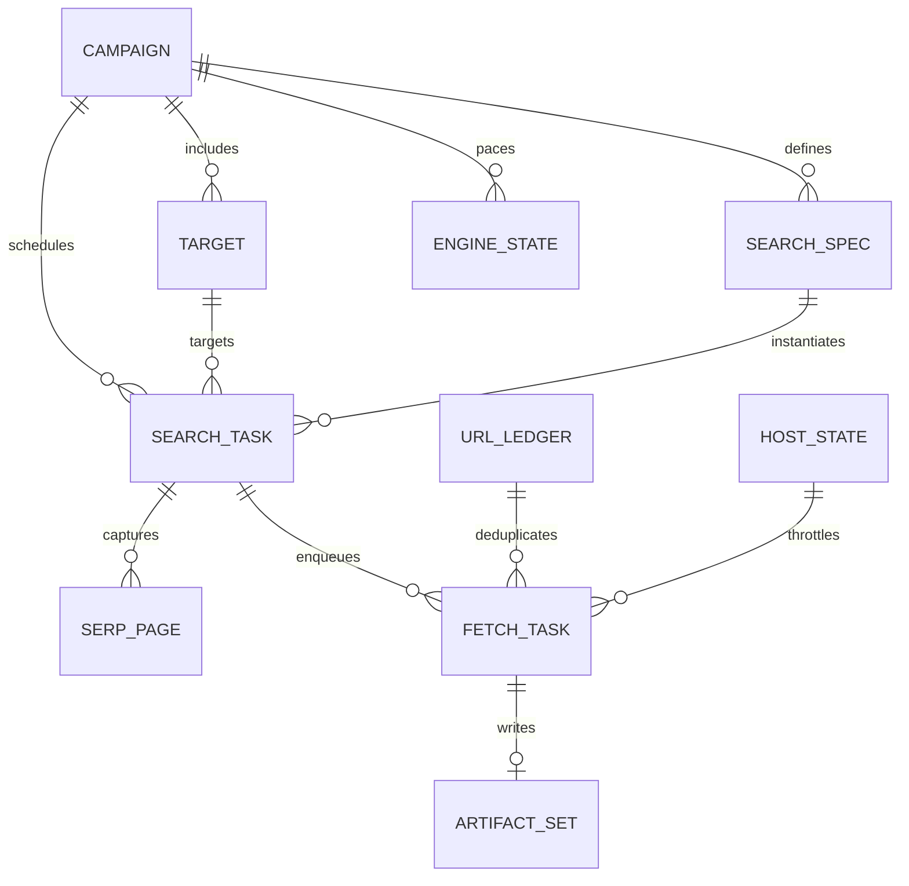
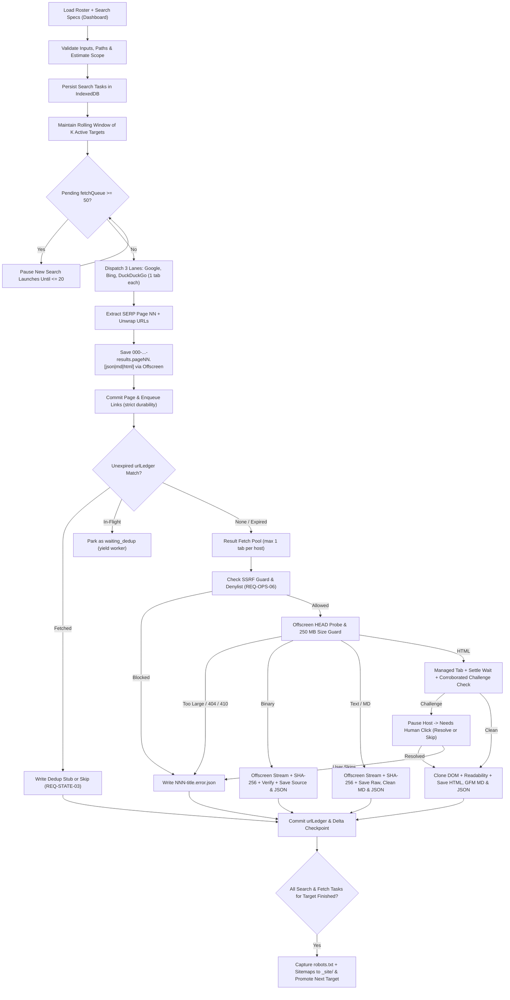
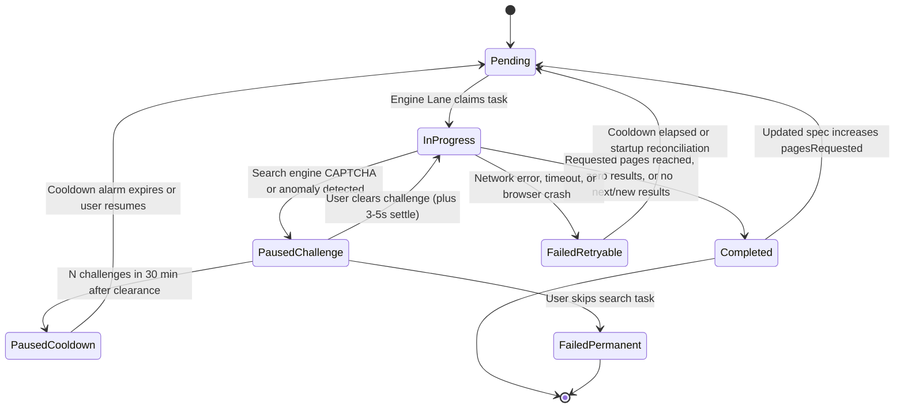
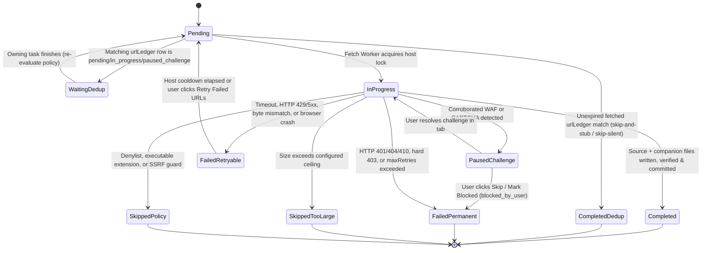

# SerpyDerpy v2 Specification: Multi-Engine Domain Search, Polite Page Archiving, and Crash-Resumable Execution

- **Status:** Approved 2026-11-22 by the maintainer (reviewed 2026-11-21; all open questions in Section 12 resolved). v2.0.0 implemented; automated unit tests pass, live Chrome/Edge browser checks pending.
- **Target Version:** `2.0.0`
- **Target Runtime:** Google Chrome and Microsoft Edge (Manifest V3) on Windows, macOS, and Linux

---

## 1. Purpose and Scope

SerpyDerpy v2 is a crash-resumable browser extension for structured web research across lists of target organizations or domains (for example, 201 universities on AI policy or 30 car companies on factory robotics). It provides:

1. **Campaign Mode:** Loads a generic Target Roster and Search Specification, runs searches simultaneously across Google, Bing, and DuckDuckGo at gentle human-like pacing, follows discovered result links to archive the original source files (`.html`/`.htm`, `.pdf`, `.txt`, `.png`, `.docx`, and other formats), clean readable Markdown (for HTML and text pages), and structured metadata sidecars, and tracks all progress persistently across browser restarts and OS reboots.
2. **Interactive Mode:** Provides manual single-tab and single-query captures from the toolbar popup using the same engine modules, safety limits, and v2 output formats as Campaign Mode.

### Explicit Non-Goals and Boundaries

1. **No automated CAPTCHA or anti-bot bypass:** SerpyDerpy must never programmatically solve, click through, compute, or bypass a CAPTCHA (Completely Automated Public Turing test to tell Computers and Humans Apart), proof-of-work gate, or human-verification challenge. When a search engine or target website presents a challenge, SerpyDerpy pauses the affected work, alerts the user, and resumes only after the user resolves the challenge in the browser tab or skips the item.
2. **No external backend or paid API dependency:** All orchestration, extraction, storage, and file writing run locally inside the browser extension using standard Manifest V3 (MV3) APIs.
3. **No destructive deletion of archived files:** SerpyDerpy never deletes previously saved files from the user's `Downloads` folder.
4. **No Firefox support in v2.0:** Version 2.0 targets Chromium Manifest V3 (Google Chrome and Microsoft Edge) only. Firefox support is out of scope for v2.0.
5. **No legacy v1.0.6 or third-party project file compatibility:** Version 2.0 does not preserve SerpyDerpy v1.0.6 or TidyTexty v1.0.7 file formats, UI quirks, or project-specific roster loaders (maintainer decisions 2026-11-20, OQ-15 and OQ-16). Projects using SerpyDerpy supply inputs in SerpyDerpy's generic formats (Section 4).

### Limits

- Pacing, decoy browsing, and native-click pagination reduce the chance of CAPTCHAs and throttling; they do not prevent them. Run-time estimates exclude time spent waiting for a human to clear a challenge.
- Engine adapters depend on each search engine's current page markup. A markup change can break extraction, pagination, or challenge detection until the adapter is updated. Zero-result and no-progress detection (`REQ-ENG-05`, `REQ-ENG-06`) limits the damage but does not detect every silent failure.
- The ad relevance test of `REQ-ENG-07` is a keyword heuristic, not a judgment of an ad's content.
- Fetches send the user's browser cookies to target sites (`credentials: "include"`), which is how a cleared WAF challenge carries over to later pages. Archived pages can therefore reflect the user's logged-in view of a site unless the user runs SerpyDerpy in a dedicated browser profile (`REQ-OPS-03`).
- Chromium Manifest V3 extensions cannot inspect DNS resolution before `fetch()` or tab navigation. The SSRF guard (`REQ-OPS-06`) blocks non-HTTP(S) schemes, private/loopback/link-local hostnames, and literal private IP addresses before fetch and after redirects, but it cannot stop a public domain whose DNS record resolves to a private RFC 1918 address.
- Chromium Manifest V3 provides no API to read the browser's `"Ask where to save each file before downloading"` preference (`REQ-OPS-03`).

---

## 2. Terminology

| Term | Definition |
| --- | --- |
| **Interactive Mode** | Manual single-tab or single-query capture triggered from the toolbar popup (`popup.html`), sharing v2 engine adapters, safety limits, and output formats. |
| **Campaign Mode** | Automated batch execution driven by a loaded Target Roster and Search Specification, managed from the full-page Campaign Dashboard (`dashboard.html`). |
| **Target** | One organization or domain entry in a Roster (for example a university, company, or agency), identified at minimum by a `domain` (such as `princeton.edu` or `toyota.com`) and optionally by `slug`, `name`, `externalId`, `order`, and arbitrary `metadata` key-value pairs. |
| **Roster** | The list of Targets in a campaign. |
| **Search Specification** | The list of search query templates and per-search parameters (such as page depth `1-20`, search slug, group label, target engines, scope, and whether to fetch result links). |
| **Search Task** | One atomic unit of search work: one `(target, searchEngine, search)` triple with a configured page depth `pagesRequested`. |
| **Search Engine Lane** | An independent asynchronous worker responsible for one search engine (`google`, `bing`, or `duckduckgo`). At most one active search tab runs per lane at any time. |
| **SERP Page** | One Search Engine Results Page (`page01` through `pageNN`) captured for a Search Task. |
| **Result Link** | An organic destination URL extracted from a SERP Page after unwrapping search-engine click-tracking redirects. |
| **Canonical URL** | A normalized form of a Result Link used for cross-search, cross-engine, and cross-campaign deduplication (lowercase scheme and host, default port removed, tracking parameters stripped, query parameters sorted, fragment removed). |
| **Fetch Task** | One queued job to download and archive a Result Link for a specific `(Search Task, overallRank)` pair. |
| **URL Ledger** | The persistent IndexedDB store (`urlLedger`) recording every Canonical URL queued, fetched, skipped, or failed across runs, along with its canonical saved artifact path, freshness timestamp, and SHA-256 content hash. |
| **Deduplication Reference Stub** | A lightweight `NNN-<page title>.json` file written when a Result Link matches an unexpired Canonical URL already archived earlier, recording the rank and pointing to the canonical saved files instead of re-fetching the remote server. |
| **Checkpoint** | A portable JSON Lines (JSONL) delta or full snapshot of campaign progress, Search Tasks, Fetch Queue, and URL Ledger written to `_state/` for backup or machine migration. |
| **WAF** | Web Application Firewall (such as Cloudflare, Akamai, Imperva, DataDome, or PerimeterX) that may serve JavaScript or access-denied interstitials to automated browsers. |

---

## 3. Interactive Mode

- **REQ-INT-01 (Manual Interactive Captures in Popup):** `popup.html` must provide:
  1. **Mode 1 (Active Search Tab):** Recognizes active tabs on Google, Bing, and DuckDuckGo search result pages and offers **Save Current Page Only** and **Save & Crawl Next Pages**.
  2. **Mode 2 (Direct Search):** Lets the user enter a query, choose Google, Bing, or DuckDuckGo, and run an immediate search, with an optional checkbox to fetch discovered result links through the built-in fetcher (`REQ-FETCH-03`).
- **REQ-INT-02 (Shared Engine Adapters, Controls, and Policies):** Interactive Mode must invoke the same engine adapters (`engines/*.js`), fetcher (`fetcher.js`), and Markdown extractor (`markdown_extractor.js`) used by Campaign Mode, with no legacy wrapper module. It must provide:
  - Custom `Subfolder` under `Downloads/` (default `SerpyDerpy/Interactive`, validated per `REQ-OUT-01`).
  - `Pages to Extract` presets `1`, `2`, `3`, `5`, `7`, `11`, plus custom integer `1` to `20`.
  - Engine-applicable toggles (`&pws=0` on Google, parallel decoy browsing, save raw SERP HTML, keep and reuse single tab, Stop Crawl keeping gathered results, and dynamic version badge).
  - The same opt-in **Record public IP in metadata** setting (default OFF, `REQ-META-04`) and the same decoy-ad relevance and `1.5%` cap rules (`REQ-ENG-07`) as Campaign Mode (maintainer decisions 2026-11-20, OQ-15 and OQ-16).
- **REQ-INT-03 (Unified v2 Output Format):** Interactive Mode must write the v2 SERP and per-URL `.json`, `.md`, and source files defined in Section 5 and Section 8, setting `mode: "interactive"` and `campaign: null`.
- **REQ-INT-04 (Non-Interference):** Running an Interactive Mode capture must not modify, corrupt, or block an active or paused Campaign Mode database state, managed window, or download-shelf setting.

---

## 4. Inputs: Generic Target Roster and Search Specifications

SerpyDerpy v2 is domain-agnostic: a campaign can target universities, car manufacturers, hospitals, government agencies, or any other list of domains (maintainer decision 2026-11-20, OQ-16). SerpyDerpy accepts minimal plain-text inputs, CSV files, and structured JSON files, normalizing all of them into one internal Campaign model.

### 4.1 Input Methods and Precedence

- **REQ-INPUT-01 (Minimal Zero-Friction Input):** A user must be able to start a campaign by supplying only:
  1. A plain-text list of target domains (one per line, for example `toyota.com`, `ford.com`, `princeton.edu`). Leading `https://`, `http://`, `www.`, and trailing `/` are stripped automatically; blank lines and lines starting with `#` are ignored.
  2. A plain-text list of search templates (one per line, for example `"factory robotics" deployment`). A line starting with `web:` sets `scope: "web"` (`REQ-INPUT-09`); all other lines default to `scope: "target-site"`.
  3. A global default page depth (default `3`; UI presets `1`, `2`, `3`, `5`, `7`, `11`, plus any custom integer `1` to `20`).
- **REQ-INPUT-02 (Per-Search Page Depth and Precedence):** A search specification must allow overriding `pages` (`1` to `20`) per search. Effective page depth precedence is: per-search `pages` > file-level `defaultPages` > Campaign global default (`3`) (maintainer decision 2026-11-19, OQ-07). Plain-text search input must support optional tab-separated columns `<template>\t<pages>\t<slug>`.
- **REQ-INPUT-03 (Generic Structured JSON and CSV Loaders):** The Dashboard loader must accept:
  1. **Target Roster JSON:** `{ "schemaVersion": 2, "rosterVersion": "<optional string>", "targets": [ { "domain", "slug", "name", "externalId", "order", "metadata", "enabled" } ] }`.
  2. **Target Roster CSV:** UTF-8 CSV with a header row. Required column: `domain`. Optional columns: `slug`, `name`, `external_id`, `order`, `enabled`. Any additional columns are preserved automatically inside `metadata.<columnName>`.
  3. **Search Specification JSON:** `{ "schemaVersion": 2, "queryListVersion": "<optional string>", "defaultPages": 3, "searches": [ { "id", "slug", "group", "template", "pages", "engines", "fetchLinks", "scope", "enabled" } ] }`.
  4. **Search Specification CSV:** UTF-8 CSV with a header row. Required column: `template`. Optional columns: `id`, `slug`, `group`, `pages`, `engines` (comma- or semicolon-separated list), `fetch_links` (`true`/`false`), `scope` (`target-site` | `web`), `enabled` (`true`/`false`).
- **REQ-INPUT-04 (Unified Campaign JSON):** SerpyDerpy must support importing and exporting a single self-contained `campaign.json` combining campaign name, `outputRoot`, roster, search specifications, engine selection, pacing, deduplication, and operational settings.

### 4.2 Normalized Input Schemas and Validation

#### Target Record (Normalized)

```json
{
  "domain": "toyota.com",
  "slug": "toyota-motor-corporation",
  "name": "Toyota Motor Corporation",
  "externalId": "TM",
  "order": 1,
  "metadata": {
    "sector": "automotive",
    "country": "JP"
  },
  "enabled": true
}
```

Normalization rules:
- `domain` (required): lowercase hostname with leading `www.` and trailing `/` removed. Invalid hostnames (missing TLD, illegal characters, scheme/path remnants) fail pre-flight validation and report the offending line or index.
- `slug` (optional): if absent, derived from `domain` by replacing `.` and non-alphanumeric runs with `-` (for example `toyota.com` -> `toyota-com`) (maintainer decision 2026-11-19, OQ-02).
- `name` (optional): if absent, stored as `null` (display UI falls back to `domain`; template guard `REQ-INPUT-06` distinguishes an explicit `name` from a missing `name`).
- `externalId` and `order` (optional): preserved as `null` when absent.
- `metadata` (optional): object of scalar key-value pairs; defaults to `{}`.

#### Search Specification Record (Normalized)

```json
{
  "id": "robotics-01",
  "slug": "factory-robotics-deployment",
  "group": "manufacturing",
  "template": "\"factory robotics\" deployment",
  "pages": 3,
  "engines": ["google", "bing", "duckduckgo"],
  "fetchLinks": true,
  "scope": "target-site",
  "enabled": true
}
```

Template expansion and scope rules:
- **REQ-INPUT-05 (Placeholder Substitution):** SerpyDerpy must expand `{domain}`, `{name}`, `{slug}`, `{externalId}`, and `{metadata.<key>}` in `template`.
- **REQ-INPUT-06 (Missing Optional Placeholder Guard):** If a search template references `{name}`, `{externalId}`, or `{metadata.<key>}` and any enabled Target omits that value, pre-flight validation must warn the user, list each affected Target and line/index, and require the user to choose either a fallback (`domain` stem for `{name}`) or skipping those `(target, search)` pairs before starting.
- **REQ-INPUT-07 (Deterministic Search Slug):** If `slug` is omitted, SerpyDerpy derives it deterministically from `template` by stripping quotes and punctuation, lowercasing, joining tokens with `-`, and applying `REQ-OUT-07` and `REQ-OUT-08`. If two templates produce the same slug within a campaign, SerpyDerpy appends `-` plus the first 4 lowercase hex characters of `SHA-256(template)` so folders never collide.
- **REQ-INPUT-08 (Pre-Run Scope Estimator and Subset Selector):** Before starting a campaign, the Dashboard must display exact counts (`targets`, `searches`, `engines`, total `Search Tasks`, already-completed tasks skipped from history, remaining tasks, and estimated wall-clock range at current pacing excluding CAPTCHA wait time) and allow filtering by target subset, `group`, individual search item, or engine for pilot runs.
- **REQ-INPUT-09 (Search Scope Builds the Query):** Each search carries `scope` (maintainer decisions 2026-11-19 OQ-09 and 2026-11-20 OQ-16):
  - `target-site` (default): SerpyDerpy builds the query as `site:{domain} ` followed by the expanded template. If a `target-site` template itself contains a `site:` operator, pre-flight validation must fail and list the offending template so the user either removes `site:` or sets `scope: "web"`.
  - `web`: SerpyDerpy sends the expanded template as written. It may contain `{name}` or its own `site:` operator (such as `site:sec.gov` or `site:campusgroups.com`).
  - SERP `.json` files record both `search.template` (as loaded) and `search.resolvedQuery` (as sent).
  - Scope never restricts which organic result links are fetched; see `REQ-OPS-06` for off-domain results.

---

## 5. Output Directory Layout, Naming Grammar, and File Handling

### 5.1 Directory Structure

- **REQ-OUT-01 (Campaign Output Root and Path Safety):** All Campaign Mode files must save under the browser's `Downloads/` directory at:
  `Downloads/<outputRoot>/<Target>/<SearchEngine>/<Search>/`
  `<outputRoot>` is configurable in Campaign Settings and defaults to `SerpyDerpy/<campaignSlug>` (for example `SerpyDerpy/ai-universities` or `SerpyDerpy/auto-robotics`). Before saving settings, SerpyDerpy must validate that `<outputRoot>` is a non-empty relative path using forward slashes only, is at most `60` characters long, and contains no `..` path segments, leading `/` or `\`, Windows drive prefixes (`C:`), or illegal Windows characters (`REQ-OUT-07`).
- **REQ-OUT-02 (Campaign-Level Artifacts):** Top-level operational artifacts save directly under `Downloads/<outputRoot>/`:
  - `README.md`: Auto-generated once per campaign when `campaigns.readmeWritten` is `false` in IndexedDB (`REQ-STATE-01`); documents the directory hierarchy, file naming grammar, JSON schemas, and deduplication stubs.
  - `_reports/YYYYMMDD-hhmmss-serpyderpy-report.md`: Concise human-readable Markdown summary containing campaign metadata, counts per engine and per target, challenge counts, off-domain counts, error counts by `errorClass`, and at most `200` sample failed/blocked URLs with a pointer to `_exports/url-ledger.jsonl` for the complete URL list (never dumping full-campaign URL lists into Markdown; maintainer decision 2026-11-20, OQ-16).
  - `_reports/YYYYMMDD-hhmmss-serpyderpy-partNNNN.log`: Rotated, complete, untruncated timestamped execution log segments flushed every `2,000` events, every `10` minutes, and on Pause, Stop, or completion so long campaigns never exhaust browser memory.
  - `_state/checkpoint-delta-NNNNNN.jsonl` and `_state/checkpoint-full-YYYYMMDD-hhmmss.jsonl`: Incremental JSONL delta checkpoints written while running plus streamed full JSONL snapshots (`REQ-STATE-07`, maintainer decision 2026-11-20, OQ-11).
  - `_exports/campaign-summary.json`, `_exports/search-tasks.jsonl`, and `_exports/url-ledger.jsonl`: Streamed machine-readable exports (`REQ-OPS-08`).

### 5.2 Exact File Naming Grammar

Inside `Downloads/<outputRoot>/<Target>/<SearchEngine>/<Search>/` (where `<SearchEngine>` is lowercase `google`, `bing`, or `duckduckgo`; maintainer decision 2026-11-19, OQ-02):

1. **Search Result Pages (SERP):**
   - **REQ-OUT-03 (SERP Filenames):** Each extracted SERP page `NN` (`01`, `02`, ..., `20`) must be saved using the base name:
     `000-<target>-<search engine>-<search>-results.pageNN`
   - Saved companion files per SERP page:
     - `000-<target>-<search engine>-<search>-results.pageNN.json` (structured SERP metadata and extracted organic results)
     - `000-<target>-<search engine>-<search>-results.pageNN.md` (clean human-readable Markdown summary of that SERP page)
     - `000-<target>-<search engine>-<search>-results.pageNN.html` (raw rendered SERP HTML snapshot; enabled by default)
   - Because each SERP filename starts with `000-`, SERP files always sort ahead of downloaded result files (`001-`, `002-`, ...). When a search sets `fetchLinks: false`, SerpyDerpy saves only the SERP files and enqueues zero `fetchQueue` tasks.

2. **Downloaded Result Pages (Followed Links):**
   - **REQ-OUT-04 (Result Filenames):** Each organic result link followed from the SERP pages of a Search Task must be saved using its consecutive overall rank `NNN` across all crawled SERP pages of that search, zero-padded to at least three digits (`001`, `002`, ..., `099`, `100`, ...) so lexical order matches rank order (maintainer decision 2026-11-19):
     `NNN-<page title>.<ext>`
   - **REQ-OUT-05 (Title Fallback Order):** `<page title>` must be derived from the first non-empty sanitized source in order:
     1. Extracted document `<title>` or Readability article title (for HTML pages).
     2. HTTP `Content-Disposition` filename stem (minus extension) for attachments, PDFs, images, and binaries.
     3. Organic result title extracted from the SERP card.
     4. URL pathname stem (minus extension) or hostname.
   - **REQ-OUT-06 (Always Save Original Source File and Companion Files):** Every successfully fetched Result Link **must save its original or rendered source file** — `.html` (or `.htm`) for web pages, and the untouched original file (`.pdf`, `.txt`, `.png`, `.jpg`, `.docx`, `.xlsx`, `.csv`, `.json`, `.zip`, and any other format) for non-HTML files — alongside its `NNN-<page title>.json` metadata sidecar, plus clean Markdown (`NNN-<page title>.md`) for `html` and `text` resources (maintainer decision 2026-11-20, OQ-16):

| Resource Kind | Examples (MIME / Extension) | Saved Files for Rank `NNN` |
| --- | --- | --- |
| **`html`** | `text/html`, `application/xhtml+xml`, `.html`, `.htm`, `.xhtml`, `.shtml`, extensionless web pages | `NNN-<page title>.html` (or `.htm`, untouched post-JS rendered DOM)<br>`NNN-<page title>.md` (clean extracted Markdown)<br>`NNN-<page title>.json` (metadata sidecar) |
| **`text`** (non-Markdown) | `text/plain`, `text/csv`, `application/json`, `application/xml`, `application/yaml`, `image/svg+xml`, `.txt`, `.csv`, `.tsv`, `.json`, `.jsonl`, `.xml`, `.yaml`, `.yml`, `.rst`, `.log`, `.ini`, `.toml`, `.sql`, `.py`, `.js`, `.css` | `NNN-<page title>.<ext>` (untouched original raw text file, for example `.txt`, `.csv`, `.svg`; if raw extension is `.json`, saves as `NNN-<page title>.raw.json` so it never collides with the metadata sidecar)<br>`NNN-<page title>.md` (frontmattered readable Markdown)<br>`NNN-<page title>.json` (metadata sidecar) |
| **`text`** (Markdown source) | `text/markdown`, `text/x-markdown`, `.md`, `.markdown`, `.mdx` | `NNN-<page title>.raw.<ext>` (untouched original Markdown)<br>`NNN-<page title>.md` (readable Markdown with SerpyDerpy frontmatter)<br>`NNN-<page title>.json` (metadata sidecar) |
| **`binary`** | `application/pdf`, Office docs (`.doc`, `.docx`, `.xls`, `.xlsx`, `.ppt`, `.pptx`, `.odt`, `.ods`, `.odp`, `.rtf`), `.epub`, images (`.png`, `.jpg`, `.jpeg`, `.gif`, `.webp`, `.tif`, `.bmp`), archives (`.zip`, `.tar`, `.gz`, `.7z`), audio/video (`.mp3`, `.mp4`, `.wav`, `.webm`), unknown binaries | `NNN-<page title>.<ext>` (untouched original binary file, for example `.pdf`, `.png`, `.docx`)<br>`NNN-<page title>.json` (metadata sidecar; `files.markdown` is `null`) |
| **Deduplicated Reference** | Canonical URL matches an unexpired fetched record under `skip-and-stub` | `NNN-<page title>.json` (metadata sidecar with `deduplication.isDuplicateReference: true` and relative pointer to canonical artifact; no network fetch) |
| **Failed / Skipped** | HTTP 4xx/5xx, network error, timeout, user-skipped block, oversized file, or denylist/SSRF block | `NNN-<page title>.error.json` (records `status`, `errorClass`, HTTP status, headers if any, attempt count, and `retryable`) |

   - **Retry precedence rule:** Because SerpyDerpy never deletes previously saved files (Non-Goal 3), if rank `NNN` fails on an early attempt (writing `NNN-<page title>.error.json`) and succeeds on a later retry (writing `NNN-<page title>.json` and companion files), `NNN-<page title>.json` supersedes `NNN-<page title>.error.json` for that rank. Downstream exports (`_exports/url-ledger.jsonl`) reflect the final succeeded state.

### 5.3 Windows NTFS Path-Length Budgeting and Filename Hygiene

Because SerpyDerpy runs on Windows (where Chrome's `chrome.downloads` API and standard NTFS paths fail above 260 characters), path-length safety is mandatory:

- **REQ-OUT-07 (Segment Sanitization):** Every path segment (`<Target>`, `<SearchEngine>`, `<Search>`, `<page title>`) must:
  1. Normalize Unicode (NFKD), strip zero-width characters (`\u200B-\u200D`, `\uFEFF`) and ASCII control characters (`0x00-0x1F`), and convert to lowercase so Windows and POSIX paths behave identically.
  2. Replace characters illegal on Windows (`< > : " / \ | ? *`) and whitespace with `-`, collapse repeated `-`, and trim leading/trailing `-`, spaces, and periods.
  3. Prefix reserved Windows device names (`con`, `prn`, `aux`, `nul`, `com1`-`com9`, `lpt1`-`lpt9`) with `_` so Windows never rejects the file.
- **REQ-OUT-08 (Total Relative Path Budget and Collision-Free Shortening):** SerpyDerpy must enforce a maximum relative path length under `Downloads/` of **185 characters**, leaving 75 characters of headroom for `C:\Users\<username>\Downloads\`.
  - Default segment caps (for `outputRoot` <= `30` chars): `<Target>` <= `36` chars, `<SearchEngine>` <= `10` chars, `<Search>` <= `40` chars, `<page title>` <= `55` chars.
  - **Target slug truncation safety:** Whenever a sanitized `<Target>` slug exceeds its cap (default `36` chars), SerpyDerpy must truncate it to `cap - 5` chars followed by `-` and the first `4` lowercase hex chars of `SHA-256(fullTargetSlug)` so distinct organizations with long shared prefixes never collide into one folder.
  - **Dynamic adjustment for long `outputRoot`:** When `len(outputRoot) > 30`, SerpyDerpy must reduce the `<Search>` and `<page title>` caps by `ceil((len(outputRoot) - 30) / 2)` each (minimum `16` chars each) so every path stays within `185` characters.
  - **Deterministic SERP filename shortening:** If `len(relDir) + 1 + len(serpFilename) > 185`, compute `h6 = SHA-256(fullTargetSlug + "/" + engine + "/" + fullSearchSlug).slice(0, 6)` and build `000-<tPart>-<engine>-<sPart>-<h6>-results.pageNN.<ext>` by shortening `<sPart>` first (down to `12` chars) and then `<tPart>` (down to `12` chars) until total relative path length is `<= 185` characters. Full untruncated slugs are always recorded inside `pageNN.json`.
- **REQ-OUT-09 (Deterministic Idempotent Conflict Handling):** When re-running or resuming a Search Task or Fetch Task, downloads for a deterministic target filename must use `conflictAction: "overwrite"` (or skip if already committed in IndexedDB) rather than `"uniquify"`, preventing duplicate `filename (1).json` clutter after retries or reboots.

---

## 6. Simultaneous Multi-Engine Search and Politeness Architecture

### 6.1 Three Independent Concurrent Engine Lanes and Scheduling

- **REQ-ENG-01 (Simultaneous 3-Engine Execution):** Campaign Mode must run **Google**, **Bing**, and **DuckDuckGo** simultaneously using three independent Search Engine Lanes (`google`, `bing`, `duckduckgo`).
- **REQ-ENG-02 (Strict Per-Engine Seriality):** Each Search Engine Lane must maintain **at most 1 active search tab** at any time. Running 3 engines simultaneously yields up to 3x throughput while never increasing request concurrency against any single search engine.
- **REQ-ENG-03 (Staggered Start and Independent Jitter):** When starting or resuming a campaign, SerpyDerpy must stagger the launch of the three lanes (Engine 1 at `t+0s`, Engine 2 at `t+4-11s`, Engine 3 at `t+9-21s`) and use independent random timers per lane so requests across engines never synchronize into lockstep bursts.
- **REQ-ENG-09 (Rolling Active Target Window):** The campaign scheduler must maintain a configurable rolling window of `K` active Targets (default `K = 4`, configurable from `1` up to total roster size; maintainer decision 2026-11-20, OQ-12). Search Engine Lanes rotate searches across the Targets in the active window so the Result Fetch Pool receives URLs spread across distinct target hosts (keeping fetch workers busy without violating `REQ-FETCH-02`'s 1-tab-per-host rule). Once every Search Task and every Fetch Task for a Target in the active window has reached a terminal state, SerpyDerpy runs `REQ-OPS-09` (`_site/` capture) for that Target and promotes the next pending Target in roster order into the active window.
- **REQ-ENG-10 (Fetch-Queue Backpressure for Search Lanes):** To keep search-engine query pacing natural and avoid building an unbounded download backlog, SerpyDerpy must pause launching new Search Tasks across all Search Engine Lanes whenever the count of `pending` Fetch Tasks in `fetchQueue` reaches a configurable high-water mark (default `50`), and resume launching new Search Tasks once `pending` Fetch Tasks drop to or below a configurable low-water mark (default `20`; setting the high-water mark to `0` disables backpressure; maintainer decision 2026-11-20, OQ-13). An in-flight Search Task finishes its current SERP page cleanly before pausing.

### 6.2 Politeness and Anti-Abuse Pacing

All pacing parameters must be configurable in Campaign Settings with gentle defaults suitable for unattended multi-day runs:

| Parameter | Default (Campaign Mode) | Purpose |
| --- | --- | --- |
| Inter-page SERP delay (within a Search Task) | Bounded random delay (`REQ-ENG-08`): min `3s`, max `30s`, mean `7.5s`, with smooth scroll and mouse simulation | Keeps large campaigns practical while remaining gentle (maintainer decision 2026-11-19) |
| Inter-query cooldown (between Search Tasks on same engine) | Bounded random delay (`REQ-ENG-08`): min `3s`, max `30s`, mean `10s` | Mimics reading results and starting a new search (maintainer decision 2026-11-19) |
| Periodic rest break ("coffee break") | `120-300s` every `15-25` completed Search Tasks (per engine) | Breaks up sustained automated cadence |
| Soft hourly / daily page cap per engine | Optional (off by default, configurable, for example 120 SERP pages/hr) | Allows hard ceiling on search volume |
| Parallel decoy browsing | Optional toggle (default ON for Google, configurable per engine; 35-65% probability, `3-33s` background tab). Ad visits are restricted by `REQ-ENG-07`. | Adds human-like browsing diversity |
| Pagination navigation | Native DOM click (`mousemove -> mousedown -> mouseup -> click`) on Next / More Results button | Avoids artificial `&start=` URL jumping where native click works |

- **REQ-ENG-04 (Engine-Isolated Challenge Circuit Breaker):** If one Search Engine Lane encounters a CAPTCHA, unusual-traffic page, HTTP 429, or anomaly challenge:
  1. Only that lane transitions to `paused_challenge` (unless `pause-all` is selected under `REQ-FETCH-05`).
  2. The other two engine lanes and the Result Fetch Pool continue running without interruption.
  3. SerpyDerpy sets the toolbar badge to `CAP!`, updates the Dashboard lane card and **Needs Human Click** banner, and fires a desktop notification (`chrome.notifications`) with a button to focus the challenged tab.
  4. SerpyDerpy must **not** steal OS window focus automatically unless the user enables "Auto-focus tab on CAPTCHA".
  5. While paused, the lane polls the tab every `2s` for challenge resolution; once cleared by the user, the lane waits an extra `3-5s` and resumes.
  6. **Escalation cooldown:** SerpyDerpy records each challenge detection timestamp in a 30-minute sliding window per engine (`engineState`). When an engine hits its `N`-th challenge (default `3`) within 30 minutes, after the user resolves (or skips) that challenge the lane enters `paused_cooldown` with persisted `cooldownUntilUtc` driven by `chrome.alarms` (`REQ-STATE-06`) in the escalating order `5 min`, `15 min`, `30 min`. If another challenge occurs after the `30 min` cooldown, the lane enters manual-resume `paused_cooldown` (`cooldownUntilUtc: null`) until the user explicitly clicks Resume.
- **REQ-ENG-07 (Decoy Ad Limits and Host Safety):** Decoy browsing in **both** Campaign Mode and Interactive Mode must obey these rules (maintainer decisions 2026-11-19 and 2026-11-20, OQ-16):
  1. A sponsored (ad) link is eligible as a decoy only if it is search-relevant: its title, display URL, or ad text contains at least one query term, or its destination host is the Target's `domain` or a subdomain of it. Query terms exclude search operators (`site:`, `filetype:`, `inurl:`, `intitle:`), quotation marks, and English function stopwords (`a, an, the, and, or, of, to, in, for, on, with, at, by, from, as, is, are, was, were, be, been, that, this, it` — preserving short domain terms such as `ai`, `ml`, `ev`).
  2. SerpyDerpy must never open a sponsored ad that fails the relevance test.
  3. For each engine, ad visits must not exceed `1.5%` of all decoy visits made by that engine. Before opening an ad, the lane checks `(adVisits + 1) / (decoyVisits + 1) <= 0.015`; otherwise it picks an organic decoy or skips the decoy.
  4. In Campaign Mode, every decoy tab must open inside the managed browser window (`REQ-OPS-01`), must pass `REQ-OPS-06` (denylist and SSRF guard), and must not open any URL whose hostname is currently held by a Fetch Worker or in `paused_challenge`.
  5. Every decoy visit is recorded in the SERP page's `decoyBrowsing.visits[]` with `type` (`organic` | `sponsored`), destination URL, dwell duration, and (for ads) the matched relevance reason. Per-engine running totals `decoyVisits` and `adVisits` persist in `engineState`.
- **REQ-ENG-08 (Bounded Configurable-Skew Delay Distribution):** The inter-page SERP delay, inter-query cooldown, and per-host fetch cooldown must each be drawn from a smooth bounded distribution on `[min, max]` with configurable `min`, `max`, and `mean` (for example the maximum-entropy truncated exponential distribution `F(x) = (exp(lambda * u) - 1) / (exp(lambda) - 1)` where `u = (x - min) / (max - min)`, with exact closed-form inverse CDF `u = ln(1 + U * (exp(lambda) - 1)) / lambda` and `lambda = 0` when `mean == (min + max) / 2`).
  - Defaults: SERP pages `min = 3s`, `max = 30s`, `mean = 7.5s`; inter-query `min = 3s`, `max = 30s`, `mean = 10s`; same-host fetch `min = 2s`, `max = 30s`, `mean = 5s` (maintainer decision 2026-11-19).
  - Settings validation must require `min < mean < max` (maintainer decision 2026-11-21, OQ-19).
  - Over 10,000 draws for any valid `(min, max, mean)`: every draw must lie in `[min, max]`, the sample mean must be within `5%` of `mean`, the sample median must be `< mean` whenever `mean < (min + max) / 2` (including all defaults), and the sample median must be `> mean` whenever `mean > (min + max) / 2`.

### 6.3 Engine-Specific Extraction and Pagination Adapters

Each search engine must be implemented as an isolated adapter module (`engines/google.js`, `engines/bing.js`, `engines/duckduckgo.js`) conforming to a common interface: `buildInitialUrl`, `detectChallenge`, `detectZeroOrRewrittenResults`, `extractPage`, `advanceToNextPage`, and `unwrapResultUrl`.

1. **Google Adapter (`google`):**
   - Initial URL: `https://www.google.com/search?q=<query>&hl=en&gl=us` plus `&pws=0` when no-personalization is enabled.
   - Pagination: Clicks `#pnnext`, `a[aria-label="Next page"]`, or numbered page fallback using native pointer events.
   - Organic extraction and redirect unwrapping: Extracts real destination from `/url?q=...` and `/url?url=...`; excludes internal Google links, sponsored ads (`data-text-ad="1"`, `/aclk?`), AI Overview containers, and People Also Ask accordion items from organic `results[]` (extracting PAA into `peopleAlsoAsk[]`).
   - Challenge detection: `/sorry/`, `#captcha-form`, `iframe[src*="recaptcha"]`, "unusual traffic", "automated queries", and cookie-consent interstitials.

2. **Bing Adapter (`bing`):**
   - Initial URL: `https://www.bing.com/search?q=<query>&setlang=en-US&cc=US`.
   - Pagination: Clicks `a.sb_pagN`, `a[title="Next page"]`, or `a[aria-label="Next page"]`.
   - Organic extraction and redirect unwrapping (mandatory): Excludes ad blocks (`.b_ad`, `.b_adTop`, `.b_adBottom`, `[data-isad="true"]`, `/aclick?`). Bing wraps organic `href` values in `https://www.bing.com/ck/a?...&u=a1<base64url>`. The adapter must strip the `a1` prefix, convert Base64URL (`-` -> `+`, `_` -> `/`), add missing `=` padding to a multiple of 4, and UTF-8 decode via `TextDecoder` to recover the real destination URL before recording or fetching, falling back to visible `<cite>` only when decoding fails (recording `urlDecodeFallback: true` in metadata).
   - Challenge detection: Bing CAPTCHA/Turnstile/Arkose challenge pages, unexpected redirect to login/interstitial, or repeated zero-result responses that indicate silent throttling.

3. **DuckDuckGo Adapter (`duckduckgo`):**
   - Default mode (standard JavaScript DuckDuckGo; maintainer decision 2026-11-19, OQ-06): Initial URL `https://duckduckgo.com/?q=<query>&kl=us-en&ia=web` (omitting `kp` so DuckDuckGo uses its normal default SafeSearch; maintainer decision 2026-11-21, OQ-18).
   - Virtual pagination: Standard DuckDuckGo appends new results into the same DOM when clicking `button#more-results` (or `[data-testid="more-results"]`). For each virtual page `NN` (`01..pagesRequested`):
     - Track previously seen result elements/URLs from pages `1..(NN-1)`.
     - Capture newly appended organic results (excluding `[data-testid="ad"]`, `.result--ad`, `/y.js?`) as page `NN`'s `results[]` slice, save the DOM snapshot at page `NN` as `pageNN.html`, and write `pageNN.md` and `pageNN.json`.
     - Click `"More Results"` smoothly to load page `NN+1`, waiting up to `15s` for new result nodes or stopping cleanly if the button disappears or yields `0` new results.
     - On crash recovery (`REQ-STATE-06`), if DuckDuckGo restarts from page `1` to reach `pagesCompleted + 1`, reconcile extracted URLs by `canonicalUrl` against already-enqueued `fetchQueue` rows for that `taskKey` so previously saved pages and ranks are never duplicated.
   - Optional HTML-endpoint fallback (`https://html.duckduckgo.com/html/?q=<query>`): Uses `"Next"` form submission when enabled in Campaign Settings.
   - Redirect unwrapping: Extracts destination from `uddg=` on `duckduckgo.com/l/?uddg=...` links.
   - Challenge detection: `anomaly.js`, "Unfortunately, bots use DuckDuckGo too", CAPTCHA form, or empty challenge shell.

### 6.4 Early Pagination Stop, Intra-Search Dedup, and Query-Quality Detection

- **REQ-ENG-05 (Zero-Result and Rewrite Detection):** Each adapter must detect explicit zero-result banners ("did not match any documents", "No results found") and query autocorrection/rewrites ("Showing results for...", "Including results for..."). Those flags (`zeroResults`, `queryRewrittenTo`, `exactMatchLost`) must be recorded in `page01.json` (`REQ-META-02`). When `zeroResults` is `true`, pagination stops immediately after `page01`.
- **REQ-ENG-06 (No-Progress Stop and Intra-Search Deduplication):** If page `k` has no Next/More-Results control, or adds `0` new unique canonical organic URLs not already seen on pages `1..(k-1)` of the same Search Task, the lane stops paginating that Search Task and sets `pagination.endReason` (`reached_requested_pages` | `no_next_button` | `no_new_results` | `zero_results`). If a canonical URL seen on an earlier page repeats on page `k` alongside other new results, record it in `pageNN.json` `results[]` with `duplicateInSameSearch: true` and do not enqueue a duplicate `fetchQueue` row for that Search Task.

---

## 7. Result Link Fetching, Content Extraction, and Clean Markdown

### 7.1 Decoupled Polite Result Fetch Pool

- **REQ-FETCH-01 (Decoupled Architecture):** Result link fetching must run in an asynchronous **Result Fetch Pool** decoupled from the three Search Engine Lanes. SERP extraction immediately persists `pageNN.[json|md|html]` and enqueues discovered links into IndexedDB (`fetchQueue`); Fetch Workers drain `fetchQueue` in parallel so slow target servers never stall search engines.
- **REQ-FETCH-02 (Per-Host Politeness and Persistent Host State):** The Result Fetch Pool must enforce **maximum 1 concurrent request or tab per target hostname** at all times, regardless of global worker concurrency (default global fetch workers: `3`, selectable `1, 2, 3, 5, 7`), plus a randomized per-host cooldown delay between consecutive fetches to the same host (default `min = 2s`, `max = 30s`, `mean = 5s`, `REQ-ENG-08`). Per-host locks, `cooldownUntilUtc`, `consecutiveBackoffs`, and `pausedByChallenge` persist in IndexedDB (`hostState`, `REQ-STATE-01`) so host politeness survives service-worker idle suspensions. Fetch tabs use the active browser profile and cookies so clearing a WAF challenge once for a host carries the clearance cookie to later pages on that host. On HTTP `429` or `503`, the pool applies per-host cooldown backoff (`30s -> 120s -> 300s`, max retries default `3`, configurable) while continuing to fetch other hosts.
- **REQ-FETCH-03 (Offscreen-Backed Multi-Format Fetch Pipeline):** For each dequeued Fetch Task (not already satisfied by `REQ-STATE-03` deduplication):
  0. **Pre-flight URL safety check:** Validate the URL against `REQ-OPS-06` (HTTP/HTTPS only, SSRF private-network guard, and denylist including default executable extensions). Blocked URLs write `NNN-<page title>.error.json` (`skipped_policy`) and never touch the network.
  1. **Pre-flight HTTP `HEAD` probe:** Run `HEAD` in the singleton offscreen document (`offscreen.js`, timeout `5s`, `credentials: "include"`, `redirect: "follow"`) to inspect `Content-Type`, `Content-Disposition`, `Content-Length`, post-redirect `finalUrl`, HTTP status, and headers. Re-check `REQ-OPS-06` (SSRF guard and denylist) on `finalUrl`.
     - If `HEAD` returns `404`, `410`, or `401`: mark `failed_permanent`, write `.error.json`, and do not open a tab.
     - If `HEAD` returns `429` or `503`: apply per-host backoff in `hostState` and mark `failed_retryable` (up to `maxRetries`).
     - If `HEAD` returns `405`, `403`, another `5xx`, or times out: fall back to tab-based loading (step 5) unless a `5xx`/timeout fails on retry.
  2. **Unified Size Guard:** Apply the configured maximum file size ceiling (default `250 MB`, configurable; maintainer decision 2026-11-19, OQ-05) to **both** `binary` and `text` direct fetches. If `Content-Length` exceeds the ceiling, do not download; if `Content-Length` is absent, stream the response body via `ReadableStream` inside `offscreen.js` and abort as soon as received bytes exceed the ceiling, saving nothing. Record `status: "skipped_too_large"` with `observedContentLengthBytes` in `NNN-<page title>.error.json` and `urlLedger`. For rendered HTML snapshots (step 5), apply a configurable DOM snapshot ceiling (default `50 MB`); if exceeded, record `skipped_too_large` rather than silently truncating.
  3. **Binary download (offscreen streaming, hash-once, verify):** If `HEAD` identifies a `binary` resource (PDF, Office doc, image, archive, media) or `Content-Disposition: attachment` (non-text):
     - Execute `fetch()` inside `offscreen.js` (so large bytes never traverse `chrome.runtime.sendMessage` 64 MiB IPC or `data:` URL limits), apply the streaming size guard, sniff magic bytes (`%PDF-`, `PK\x03\x04`, `\x89PNG`, `\xFF\xD8\xFF`, `GIF8`, `RIFF...WEBP`) when MIME is `application/octet-stream` or extensionless, compute `SHA-256` in memory over the raw bytes, create a `Blob` URL in `offscreen.js`, download via `chrome.downloads.download` (`conflictAction: "overwrite"`), revoke the Blob URL on completion, and write `NNN-<page title>.json`.
     - **Strict download verification:** Wait for `chrome.downloads.onChanged` to reach `state === "complete"` and verify `item.danger === "safe"` and `item.fileSize === fetchedByteCount`. Never treat a download timeout or interrupted/dangerous state as success. If byte counts mismatch or any companion-file write fails, mark `failed_retryable` (or trigger `REQ-OPS-10` on disk errors) and never mark `fetched`.
     - **WAF fallback for binaries:** If `fetch()` fails due to a WAF or JavaScript challenge, open the URL in a background tab for human clearance (`REQ-FETCH-04`); once cleared (clearance cookie stored), retry `offscreen.js` `fetch()` once so bytes are hashed and verified cleanly. Only if that retry also fails may SerpyDerpy fall back to direct `chrome.downloads.download`, recording `resource.sha256: null` and `resource.sha256Reason`.
  4. **Text download (offscreen, charset-aware):** If `HEAD` identifies a `text` resource (`.txt`, `.md`, `.csv`, `.json`, `.xml`, `.yaml`, `.svg`, etc.): fetch raw bytes as `ArrayBuffer` inside `offscreen.js` with the streaming size guard, compute `SHA-256` on the untouched raw bytes, decode text using `TextDecoder` from the HTTP `charset=` header or UTF-8 BOM (defaulting to `utf-8`, falling back to `windows-1252` with a warning in `extraction.warnings` if invalid UTF-8), save the untouched raw source file (`NNN-<page title>.<ext>`, `.raw.md`, or `.raw.json`), generate and save `NNN-<page title>.md`, and write `NNN-<page title>.json`. Fall back to tab loading (step 5) if `fetch()` is blocked by a WAF/JS challenge.
  5. **HTML tab loading and extraction:** For `html` resources (or `HEAD` fallback):
     - Open a background tab inside the managed window (`REQ-OPS-01`) and call `chrome.tabs.update(tabId, { autoDiscardable: false })` so Chrome/Edge never discards active or challenged tabs.
     - Listen to `chrome.webNavigation.onErrorOccurred` (`"webNavigation"` permission) to classify DNS, TLS, connection-refused, and abort failures explicitly in `.error.json`.
     - Wait for `status === "complete"` (`30s` safety guard), run randomized settle wait (configurable, default `7-21s`) with pointer/mouse/scroll simulation (`simulateHumanActivity`), and check `REQ-OPS-06` (SSRF guard and denylist) on post-redirect `finalUrl`.
     - Inspect `performance.getEntriesByType("navigation")[0].responseStatus` (when exposed): if `>= 400` and no interactive challenge is present (`REQ-FETCH-04`), do **not** save as `fetched` — classify `404`/`410`/`401`/`403` as `failed_permanent` and `429`/`5xx` as `failed_retryable` (with host backoff on `429`/`503`) and write `.error.json`.
     - Run corroborated challenge detection (`REQ-FETCH-04`).
     - Probe `document.contentType` and `embed[type="application/pdf"]`; re-classify if the page resolved to an embedded PDF or plain text.
     - Wrap every `chrome.scripting.executeScript` call in a `20s` timeout. Before extraction, clone the DOM (`document.cloneNode(true)`) so `preCleanDocument` and `Readability.js` never mutate the live page; capture the untouched post-JS `document.documentElement.outerHTML` as `NNN-<page title>.html`, compute `SHA-256` over its UTF-8 bytes, save `.html`, `.md`, and `.json` through `offscreen.js` Blob URLs with download verification, clear `window.onbeforeunload = null`, and close the tab.
- **REQ-FETCH-04 (Target-Page CAPTCHA, Cloudflare, and WAF Pause-for-Human Guard):** SerpyDerpy must never record a CAPTCHA, Cloudflare interstitial, or WAF challenge page as a captured document. After the settle wait on every loaded HTML tab, SerpyDerpy inspects URL, HTTP status, title, DOM selectors, and visible body text using **interstitial corroboration** (preventing false positives on normal pages that embed a footer reCAPTCHA widget or mention "Access Denied" in documentation):
  - **Standalone challenge signatures** (always trigger pause): Cloudflare `#challenge-running`, `#cf-challenge-running`, `#challenge-form`, title `"Just a moment..."` or `"Attention Required! | Cloudflare"`, `iframe[src*="challenges.cloudflare.com"]` on an interstitial shell; DataDome `geo.captcha-delivery.com`; PerimeterX / HUMAN `#px-captcha`; AWS WAF CAPTCHA interstitial; Sucuri / Imperva / Incapsula interstitials.
  - **Corroborated generic signatures** (trigger pause only when paired with HTTP status `403`/`429`/`503`, OR visible text `< 1,500` characters outside `<script>`/`<style>`, OR challenge keywords in `<title>`): `iframe[src*="recaptcha"]`, `iframe[src*="hcaptcha"]`, `.g-recaptcha`, `.h-captcha`, `#captcha-form`, `"Verify you are human"`, Akamai `"Access Denied"` / `_abck`.
  When a challenge triggers:
  1. SerpyDerpy must **not** save the challenge HTML/Markdown as a captured page and must keep the tab open (`autoDiscardable: false`).
  2. SerpyDerpy transitions the Fetch Task to `paused_challenge`, marks `hostState.pausedByChallenge = true` so no other requests hit that host, adds the tab to the Dashboard's **Needs Human Click** queue (with **Focus Tab** and **Skip / Mark Blocked** controls), updates the badge (`CAP!`), and fires a desktop notification.
  3. SerpyDerpy polls the tab every `2s` until the challenge clears and destination content renders (or until the user clicks **Skip / Mark Blocked**).
  4. Once cleared by the user, SerpyDerpy waits `2-3s`, re-verifies the challenge signature is gone, performs normal extraction and saving, records `challenge: { encountered: true, provider, resolvedByHuman: true, waitDurationMs }` in `NNN-<page title>.json`, clears `hostState.pausedByChallenge`, and resumes queued tasks for that host.
  5. If the user clicks **Skip / Mark Blocked**, SerpyDerpy marks the Fetch Task and `urlLedger` entry `failed_permanent` with `errorClass: "blocked_by_user"` and `retryable: false`, writes `NNN-<page title>.error.json`, closes the tab, and releases the host lock (maintainer decision 2026-11-20, OQ-17). Bulk **Retry Failed URLs** skips `blocked_by_user` items; only manual selection in the Dashboard table retries them.
- **REQ-FETCH-05 (Configurable Pause Scope on CAPTCHA):** Campaign Settings must provide a pause-scope setting for challenges (maintainer decision 2026-11-19, OQ-08):
  - `pause-affected-only` (default): pause only the affected Search Engine Lane or affected target host while other lanes and hosts keep working.
  - `pause-all`: pause all Search Engine Lanes and Fetch Workers immediately until all open challenges are resolved or skipped.

### 7.2 Clean, Easily Readable Markdown Standard

- **REQ-MD-01 (DOM Normalization and Dual-Candidate Extraction):** HTML-to-Markdown conversion must bundle Mozilla `Readability.js`, run on a cloned document (`document.cloneNode(true)`), apply modern documentation DOM normalization (unwrapping React/MDX/Docusaurus/Mintlify card links, badges, accordions) and pre-cleaning (stripping scripts, styles, navbars, sidebars, TOC chrome, cookie banners, modals, forms, ads, social share buttons, hidden elements, and comments), and compare Readability against direct semantic-container extraction (`#content-area, #content, .mdx-content, article, main, [role="main"]`). Choose the semantic candidate when Readability returns under `120` characters or drops more than `25%` of semantic text (`semantic.length > readability.length * 1.35`).
- **REQ-MD-02 (Clean Readable Markdown Formatting):** Generated `.md` files must:
  1. Start with YAML frontmatter containing `URL`, `Final-URL`, `Title`, `Target`, `Search-Engine`, `Search`, `Rank`, `SERP-Page`, `Retrieved-Timestamp`, `Content-SHA256` (SHA-256 of the saved raw source file bytes), `Extraction-Method`, and `Truncated`.
  2. Begin the body with a single `# <Title>` heading (never duplicating the title if the body already opens with it).
  3. Emit valid GitHub Flavored Markdown (GFM) tables with a `| --- | --- |` header separator row, properly indented nested lists, fenced code blocks with language hints when known, clean blockquotes, and definition lists.
  4. Strip zero-width characters (`\u200B-\u200D`, `\uFEFF`), convert non-breaking spaces (`\u00A0`) to ordinary spaces, normalize line endings to `\n`, collapse 3+ blank lines to a single blank line, and fix orphaned punctuation spacing.
  5. Preserve hyperlinks as `[anchor text](absolute-url)` by default, with an optional campaign setting for plain anchor text only.
  6. Format text/code/data source files with frontmatter, `# <Title>`, and an appropriate fenced code block for structured/code formats or unwrapped prose for `.txt`/`.md` (stripping duplicate upstream YAML frontmatter from `.md` sources while preserving the untouched original in `.raw.md`).
- **REQ-MD-03 (SERP Page Markdown Formatting):** Each `000-...-results.pageNN.md` must include YAML frontmatter (`Target`, `Domain`, `Search-Engine`, `Search`, `Query`, `SERP-URL`, `Page`, `Pages-Requested`, `Retrieved-Timestamp`, `Results-On-Page`, `Zero-Results`), a `# Search Results` heading, numbered entries (`## NN. [Title](URL)`) with site name/domain, snippet, and local companion filename link if fetched/stubbed, followed by `### People Also Ask` and `### Related Searches` when present.
- **REQ-MD-04 (Content-Alteration Transparency):** SerpyDerpy must never silently truncate extracted text. Every HTML and text `.json` sidecar must record `extraction.method`, `extraction.rawChars`, `extraction.markdownChars`, `extraction.readabilityCandidateChars`, `extraction.semanticCandidateChars`, `extraction.truncated` (boolean), and `extraction.warnings[]`.

---

## 8. Metadata and Export Schemas

All SerpyDerpy v2 JSON sidecars and exports use a single lean v2 schema with no legacy v1.0.6 or TidyTexty v1.0.7 boilerplate (maintainer decisions 2026-11-20, OQ-15 and OQ-16).

- **REQ-META-01 (Self-Describing Relative-Path Sidecars):** Every SERP `.json` and per-URL `.json` must include `schemaVersion` (`2`), `mode` (`"campaign"` | `"interactive"`), `extension` (`{ name, version }`), and `files` containing filenames relative to the containing `<Search>` (or Interactive capture) directory. Sidecars must never contain machine-local absolute paths such as `C:\Users\...`.
- **REQ-META-02 (SERP Page JSON):** `000-<target>-<search engine>-<search>-results.pageNN.json` must contain:
  - `schemaVersion`, `mode`, `extension`
  - `campaign`: `null` in Interactive Mode; in Campaign Mode `{ campaignId, runId, rosterVersion, queryListVersion, target: { externalId, name, slug, domain, metadata }, searchEngine, search: { id, group, slug, scope, template, resolvedQuery } }`
  - `environment`: `{ ipAddress, ipAddressRecorded, userAgent, platform, language, timezone }`
  - `searchMetadata`: `{ query, initialSearchUrl, pageUrl, pageNumber, pagesRequested, noPersonalizationApplied, resultsOnPage, zeroResults, queryRewrittenTo, exactMatchLost, challenge: { encountered, provider, resolvedByHuman, waitDurationMs }, pagination: { hasNextPage, endReason }, timestamps: { startedUtc, startedLocal, completedUtc, completedLocal, durationMs } }`
  - `decoyBrowsing`: `{ enabled, preference, visits[] }`
  - `files`: `{ relativeDir, markdown, html, json }` (where `relativeDir` is relative to `Downloads/`)
  - `results[]`: for each organic result on this page: `{ overallRank, pageNumber, pageRank, title, rawHref, resolvedUrl, canonicalUrl, domain, offDomain, duplicateInSameSearch, urlDecodeFallback, siteName, snippet, extractedTimestampUtc }`
  - `peopleAlsoAsk[]` and `relatedSearches[]`
- **REQ-META-03 (Per-URL Result JSON):** `NNN-<page title>.json` must contain:
  - `schemaVersion`, `mode`, `extension`, `campaign`
  - `serpContext`: `{ pageNumber, pageRank, overallRank, serpTitle, serpSnippet, serpJsonFile }` (`null` if fetched standalone)
  - `fetchedAt`: `{ utc, local, unixEpochMs, processingDurationMs, attemptNumber }`
  - `url`: `{ requested, canonical, final, finalCanonical, offDomain, protocol, hostname, pathname, search, referrer }`
  - `resource`: `{ kind, title, fileExtension, mimeType, characterSet, lastModified, fileSizeBytes, sha256, sha256Reason }`
  - `http`: `{ status, protocol, headersSource, responseHeaders }`
  - `extraction`: `{ method, rawChars, markdownChars, readabilityCandidateChars, semanticCandidateChars, truncated, warnings }` (`null` for `binary`)
  - `challenge`: `{ encountered, provider, resolvedByHuman, waitDurationMs }`
  - `deduplication`: `{ isDuplicateReference, canonicalCampaignId, canonicalOutputRoot, canonicalArtifactRelPath, firstFetchedUtc, firstSeenTaskKey }` (where `canonicalArtifactRelPath` is relative to `Downloads/` so cross-campaign references resolve cleanly across different `outputRoot` folders)
  - `files`: `{ source, markdown, metadata }` (relative filenames in this folder; `source` is the `.html`/`.htm`/`.pdf`/`.txt`/`.png`/`.raw.json`/etc. file; `markdown` is `.md` or `null` for binaries; `source` and `markdown` are `null` for dedup stubs)
  - `environment`: `{ ipAddress, ipAddressRecorded, userAgent, platform, language, timezone }`
- **REQ-META-04 (Public IP Recording Is Opt-In Everywhere):** Settings must include a **Record public IP in metadata** toggle, **default OFF** in both Campaign Mode and Interactive Mode (maintainer decisions 2026-11-19 and 2026-11-20, OQ-16). When OFF, SerpyDerpy must never contact any external IP-lookup service, and every `.json` records `environment.ipAddress: null` and `environment.ipAddressRecorded: false`. When ON, SerpyDerpy looks up the public IP once per browser session, refreshes at most once per hour, and records `ipAddressRecorded: true`.
- **REQ-META-05 (Error, Site-Capture, Export, and Checkpoint Schemas):** SerpyDerpy must conform to these five companion schemas:
  1. **Error / Skip Sidecar (`NNN-<page title>.error.json`):** `{ schemaVersion: 2, mode, extension, campaign, serpContext, url: { requested, canonical, final, offDomain }, status ("failed_retryable" | "failed_permanent" | "skipped_too_large" | "skipped_policy"), errorClass ("http_4xx" | "http_5xx" | "network_error" | "timeout" | "waf_challenge" | "blocked_by_user" | "too_large" | "denylist" | "ssrf_blocked" | "download_error"), httpStatus, reason, retryable, attemptCount, observedContentLengthBytes, responseHeaders, timestamps: { firstAttemptUtc, lastAttemptUtc } }`.
  2. **Site-Capture Manifest (`<Target>/_site/site-capture.json`):** `{ schemaVersion: 2, campaignId, target, capturedAtUtc, cap: 50, truncated, sitemapsDiscoveredCount, entries: [ { url, kind ("robots" | "sitemap" | "sitemap_index"), httpStatus, savedFile, fileSizeBytes, sha256, retrievedAtUtc, error } ] }`.
  3. **Campaign Summary Export (`_exports/campaign-summary.json`):** `{ schemaVersion: 2, campaignId, campaignName, outputRoot, rosterVersion, queryListVersion, status, config, createdAtUtc, updatedAtUtc, counts: { targets, searchTasksByStatus, fetchTasksByStatus, offDomainResults, challengesEncountered }, exportFiles: { searchTasksJsonl, urlLedgerJsonl } }`.
  4. **Streamed Export JSONL (`_exports/search-tasks.jsonl` and `_exports/url-ledger.jsonl`):** One JSON object per line. Each `search-tasks.jsonl` row carries `{ taskKey, campaignId, targetSlug, targetDomain, externalId, searchId, group, searchSlug, engine, scope, template, resolvedQuery, pagesRequested, pagesCompleted, status, resultCount, paginationEndReason, serpRelDir, updatedAtUtc }`. Each `url-ledger.jsonl` row carries `{ campaignId, targetSlug, externalId, engine, searchSlug, overallRank, requestedUrl, canonicalUrl, finalUrl, offDomain, status, errorClass, httpStatus, kind, mimeType, fileSizeBytes, contentSha256, artifactRelPath, fetchedAtUtc }`, where `serpRelDir` and `artifactRelPath` are relative to `Downloads/`.
  5. **Checkpoint JSONL (`_state/checkpoint-delta-NNNNNN.jsonl` and `_state/checkpoint-full-YYYYMMDD-hhmmss.jsonl`):** Line 1 is `{ "type": "header", "schemaVersion": 2, "checkpointKind": "full" | "delta", "seq": N, "campaignId": "...", "exportedAtUtc": "..." }`; body lines are `{ "type": "campaign" | "searchTask" | "urlLedger" | "fetchQueue" | "engineState" | "hostState", "data": { ... } }`; the final line is `{ "type": "footer", "recordCount": N, "sha256": "<SHA-256 of all prior lines>" }`.

---

## 9. Persistent History, Deduplication, and Crash/Reboot Resume

### 9.1 Storage Architecture (IndexedDB + `unlimitedStorage`)

A large campaign (for example 201 targets x 192 searches x 3 engines = 115,776 Search Tasks and 1,000,000+ discovered URLs) exceeds the default 10 MB `chrome.storage.local` quota and cannot be serialized in memory as one JSON blob.

- **REQ-STATE-01 (IndexedDB Persistence):** SerpyDerpy v2 must declare `"unlimitedStorage"` in `manifest.json` and store all campaign state, search history, host state, and URL history in an ACID-transactional IndexedDB database (`SerpyDerpyDB`). Lightweight UI preferences may remain in `chrome.storage.local`.



Required IndexedDB object stores:
1. `campaigns`: keyed by `campaignId`; stores name, config, pacing, `outputRoot`, `rosterVersion`, `queryListVersion`, `readmeWritten`, `nextDeltaSeq`, `nextLogPart`, `siteCapturedTargets[]`, `status` (`idle` | `running` | `paused` | `paused_interrupted` | `paused_error` | `completed` | `stopped`), created/updated timestamps.
2. `searchTasks`: keyed by deterministic `taskKey` (`<campaignId>::<targetSlug>::<engine>::<searchSlug>`); indexed by `[campaignId, engine, status]`, `[campaignId, status]`, and `targetSlug`; stores `resolvedQueryHash`, `pagesRequested`, `pagesCompleted`, `lastSerpUrl`, `nextRank`, `status`, `paginationEndReason`, `resultCount`, `attemptCount`, `lastError`, `updatedAtUtc`.
3. `urlLedger`: keyed by `<campaignId>::<canonicalUrlHash>`; indexed by `[canonicalUrlHash, fetchedAtUtc]` (supporting fast global lookups across campaigns without re-keying when toggling global deduplication), `campaignId`, `host`, `status`, and `fetchedAtUtc`; stores `campaignId`, `outputRoot`, `canonicalUrl`, `finalCanonicalUrl`, `sampleRawUrl`, `title`, `host`, `offDomain`, `status` (`pending` | `in_progress` | `paused_challenge` | `fetched` | `failed_retryable` | `failed_permanent` | `skipped_too_large` | `skipped_policy`), `errorClass`, `httpStatus`, `kind`, `mimeType`, `fileSizeBytes`, `contentSha256`, `canonicalArtifactRelPath` (relative to `Downloads/`), `firstSeenTaskKey`, `fetchedAtUtc`, `attemptCount`, `lastError`.
4. `fetchQueue`: keyed by `<taskKey>::<overallRank>`; indexed by `[campaignId, status]`, `[campaignId, targetSlug, status]`, `host`, and `canonicalUrlHash`; stores `taskKey`, `campaignId`, `targetSlug`, `engine`, `searchSlug`, `pageNumber`, `pageRank`, `overallRank`, `serpTitle`, `serpSnippet`, `rawUrl`, `canonicalUrl`, `canonicalUrlHash`, `host`, `status`, `attemptCount`, `lastError`.
5. `engineState`: keyed by `<campaignId>::<engine>`; stores `status`, `activeTabId`, `activeTaskKey`, `cooldownUntilUtc`, `challengeWindowTimestamps[]`, `escalationLevel`, `queriesSinceBreak`, `lastRequestUtc`, `decoyVisits`, `adVisits`.
6. `hostState`: keyed by `host`; stores `cooldownUntilUtc`, `consecutiveBackoffs`, `pausedByChallenge`, `activeFetchKey`, `lastRequestUtc`.
7. `events`: bounded ring buffer (max `5,000` recent rows in IndexedDB for live Dashboard display) of structured audit entries (`timestampUtc`, `campaignId`, `level`, `component`, `message`, `details`); full untruncated history flushes continuously to rotated `_reports/...-partNNNN.log` segments (`REQ-OUT-02`).

### 9.2 URL Canonicalization and Deduplication

- **REQ-STATE-02 (Canonical URL Normalization and Redirect Aliasing):** Before checking or inserting into `urlLedger`, SerpyDerpy must normalize each unwrapped Result Link by: lowercasing scheme and hostname, removing default ports (`:80`, `:443`), stripping URL fragments (`#...`), removing known tracking query parameters (`utm_*`, `fbclid`, `gclid`, `msclkid`, `mc_cid`, `mc_eid`, `srsltid`, `_ga`), sorting remaining query parameters by `(key, value)` pairs, and normalizing trailing slashes on root paths. The untouched original URL is always preserved in metadata. When a fetch redirects to a different `finalUrl` (for example `http://` -> `https://`), SerpyDerpy computes `finalCanonicalUrl`, checks `urlLedger` for an unexpired match on `finalCanonicalUrl` before writing/extracting, and records both canonical keys pointing to the saved canonical artifact so later hits to either URL deduplicate cleanly.
- **REQ-STATE-03 (Configurable Deduplication Scope, Freshness, Non-Blocking Wait, and Policy):** Campaign Settings must include:
  - **Share URL history across campaigns (global ledger):** toggle, **default ON** (maintainer decision 2026-11-20, OQ-10). When ON, deduplication queries `[canonicalUrlHash, fetchedAtUtc]` across all campaigns for the newest matching row; when OFF, it checks only rows matching the current `campaignId`.
  - **Freshness window:** configurable age ceiling (**default `30` days**, configurable to any positive integer number of days or unlimited; maintainer decision 2026-11-20, OQ-10). Any `urlLedger` record older than the configured freshness window is treated as expired and **must be re-downloaded** regardless of global or campaign-specific scope.
  - **In-flight non-blocking wait:** If a matching `urlLedger` record is `pending`, `in_progress`, or `paused_challenge` (owned by another Fetch Task), this Fetch Task transitions to `waiting_dedup` and immediately yields its Fetch Worker slot (never occupying a worker while waiting). Once the owning task reaches a terminal state, `waiting_dedup` tasks re-evaluate against the resulting `urlLedger` record. Two Fetch Tasks must never fetch the same Canonical URL simultaneously.
  - **Dispositions for unexpired matches:**
    - Match is `fetched`:
      - **`skip-and-stub` (default; OQ-01):** Do not request the remote server; write `NNN-<page title>.json` with `deduplication.isDuplicateReference: true` and `canonicalArtifactRelPath`; mark Fetch Task `completed_dedup`.
      - **`skip-silent`:** Do not request the remote server and do not write a stub file; mark Fetch Task `completed_dedup`.
      - **`refetch-per-search`:** Fetch and save a full copy in every `<Search>` folder regardless of prior history.
    - Match is unexpired `failed_permanent`, `skipped_too_large`, or `skipped_policy`: do not re-fetch; write `NNN-<page title>.error.json` citing the prior ledger disposition and mark the Fetch Task with the same terminal status (unless the user manually initiates retry).
    - Match is `failed_retryable`: eligible to retry once `hostState.cooldownUntilUtc` elapses, up to `maxRetries` (default `3`).
- **REQ-STATE-04 (Incremental Roster and Search Updates):** Loading an updated Roster or Search Specification into an existing Campaign compares deterministic `taskKey` values against `searchTasks`:
  1. Unchanged `completed` Search Tasks remain untouched.
  2. If an updated search increases `pagesRequested` above `pagesCompleted` on a `completed` Search Task whose `paginationEndReason` was `reached_requested_pages`, reopen that task to `pending` starting at `pagesCompleted + 1`.
  3. If an updated search reuses an existing `slug` with a different `resolvedQueryHash`, pre-flight validation must warn and require the user to choose skip, overwrite, or mint a new slug.

### 9.3 Atomic Checkpointing and Crash/Reboot Recovery

- **REQ-STATE-05 (Atomic Commit Points):**
  0. Every commit-point transaction below must open with `{ durability: "strict" }` so IndexedDB flushes commits to disk before reporting completion.
  1. Immediately after a SERP page `NN`'s `.md`, `.html`, and `.json` finish downloading and pass verification (`REQ-FETCH-03`), SerpyDerpy commits `pagesCompleted = NN`, `lastSerpUrl`, `nextRank`, and the newly discovered `fetchQueue` rows in a single IndexedDB transaction.
  2. Immediately after a Fetch Task finishes writing and verifying its companion files (or dedup stub / error sidecar), SerpyDerpy commits the `urlLedger` row and `fetchQueue` terminal state in a single IndexedDB transaction.
  3. A sudden OS reboot therefore loses at most the in-flight SERP page per lane and the in-flight Fetch Task per worker. Any file written before its commit is overwritten cleanly on resume (`REQ-OUT-09`).
- **REQ-STATE-06 (MV3 Service-Worker Watchdog, Alarms, and Startup Recovery):**
  1. All waits longer than `15s` (inter-query cooldowns, coffee breaks, host `429`/`503` backoffs, and escalation cooldowns) must be driven by persisted `cooldownUntilUtc` timestamps and `chrome.alarms` (never in-memory `setTimeout`), plus a 1-minute watchdog alarm while a campaign is active.
  2. Register `chrome.runtime.onStartup` (invoked on browser launch after a reboot or browser exit) separately from routine MV3 service-worker idle wake-up:
     - **Routine SW idle wake-up (live browser session):** Verify `activeTabId` tabs still exist, resume active waits from persisted `cooldownUntilUtc`, and continue running without interrupting the campaign.
     - **Browser launch (`onStartup`) with a `running` campaign:** Reset orphaned `in_progress` `searchTasks`, `fetchQueue`, `urlLedger`, and `hostState` locks back to `pending`, restore `chrome.downloads.setUiOptions({ enabled: true })` if pausing, and apply the **On Browser Restart** setting (maintainer decision 2026-11-19, OQ-03):
       - `prompt` (default): transition campaign to `paused_interrupted`, set badge `!`, fire a desktop notification ("SerpyDerpy campaign was interrupted; click to resume"), and resume from the exact checkpoint on one click.
       - `auto-resume`: wait a configurable startup settle delay (default `15s`) and automatically resume all non-challenged lanes and fetch workers.
- **REQ-STATE-07 (Portable Disk Checkpoint Export and Import):** While a campaign is running, SerpyDerpy must write small numbered JSONL delta checkpoints (`_state/checkpoint-delta-NNNNNN.jsonl`, containing only records committed since the prior delta) after each completed Target or every `10` minutes, whichever comes first (maintainer decision 2026-11-20, OQ-11). On Pause, Stop, campaign completion, or **Export Full Checkpoint**, SerpyDerpy must stream a complete chunked JSONL snapshot (`_state/checkpoint-full-YYYYMMDD-hhmmss.jsonl`, never overwriting earlier full snapshots) via `offscreen.js` Blob URLs so `1,000,000+`-URL campaigns never exhaust memory. **Import Checkpoint** must accept a full `.jsonl` snapshot plus any newer `checkpoint-delta-*.jsonl` files, verify every footer `recordCount` and `sha256`, validate all relative paths against traversal (`REQ-UI-04`), and replay them in sequence order.

---

## 10. System Architecture, UI, and Operational Capabilities

### 10.1 End-to-End Execution Pipeline and Lifecycles



**Search Task Lifecycle:**



**Fetch Task Lifecycle:**



### 10.2 UI Architecture: Popup vs. Full-Page Campaign Dashboard

- **REQ-UI-01 (Popup Stays Fast and Compact):** `popup.html` remains the quick entry point for Interactive Mode (`REQ-INT-01`), displays a compact Campaign Status card when a campaign is loaded/running/paused/errored (with Pause/Resume buttons), and provides a prominent **Open Campaign Dashboard** button.
- **REQ-UI-02 (Dedicated Campaign Dashboard Tab):** Because Chrome/Edge on Windows automatically closes extension popups whenever an OS file-picker opens, all Campaign Mode configuration and monitoring must live in a full extension tab (`dashboard.html`, registered as `options_page`). The Dashboard must include:
  1. **Setup & Loader Panel:** Drag-and-drop or file picker for Roster (JSON/CSV/TXT) and Search Specs (JSON/CSV/TXT), paste textareas for minimal domain list + template list, per-search page-depth editor (`1-20`), engine checkboxes, rolling-window (`K`), backpressure (`50`/`20`), deduplication (global toggle + freshness window), pacing controls, and Scope Estimator.
  2. **Live Operations Panel:** Three side-by-side Search Engine Lane cards (Google, Bing, DuckDuckGo) showing current Target, search, page `X / Y`, countdown timer, status badge, and per-lane Pause/Resume/Focus-Tab buttons; a Result Fetch Pool card showing active hosts, queue depth, backpressure state, and completed/deduped/failed counters; and a prominent **Needs Human Click (Challenge Queue)** banner with **Focus Tab** and **Skip / Mark Blocked** buttons.
  3. **History & Ledger Inspector:** Searchable, filterable table of Search Tasks and URL Ledger entries with **Retry Failed Searches** and **Retry Failed URLs** (which retry `failed_retryable` only) plus manual row selection to retry `failed_permanent` / `blocked_by_user` items explicitly.
  4. **Checkpoints & Exports Panel:** Export/Import Checkpoint JSONL, Export Campaign Summary + Search Tasks + URL Ledger (`_exports/`), Export Campaign Report (`.md`) and Log segments (`.log`), and Reset/Archive Campaign controls.
- **REQ-UI-03 (Campaign Pause vs. Stop Semantics):** Both **Pause** and **Stop** must finish any in-flight SERP page extraction or Fetch Task cleanly and commit it before halting, release `chrome.power` keep-awake (`REQ-OPS-04`), and write a full checkpoint (`REQ-STATE-07`) (maintainer decision 2026-11-20, OQ-14):
  - **Pause (`status: "paused"`):** Starts no new Search Tasks or Fetch Tasks, keeps open lane tabs ready (no report written), and resumes immediately when the user clicks **Resume**.
  - **Stop (`status: "stopped"`):** Drains in-flight work cleanly, closes automated worker/lane tabs, restores `chrome.downloads.setUiOptions({ enabled: true })`, writes the campaign summary report (`_reports/...-report.md`), flushes the current log segment, writes a full checkpoint (`REQ-STATE-07`), and remains **resumable** later (or archivable via **Reset/Archive Campaign**). Closing `dashboard.html` while a campaign is running does not pause or stop the campaign; reopening `dashboard.html` re-hydrates live state from IndexedDB and the service worker.
- **REQ-UI-04 (Safe UI Rendering and Path Validation):** `dashboard.html` and `popup.html` must render all untrusted external strings (SERP titles, snippets, page titles, URLs, hostnames, error messages) exclusively using `textContent` and safe DOM node APIs (never `innerHTML`, `outerHTML`, or `insertAdjacentHTML`). Clickable links rendered in the UI must permit only `http:` and `https:` URLs. All user-supplied or checkpoint-imported relative paths must reject `..` segments, leading `/` or `\`, and Windows drive prefixes.

### 10.3 Operational Capabilities Required for Reliable Unattended Runs

1. **REQ-OPS-01 (Dedicated Managed Browser Window):** Provide an enabled-by-default toggle in Campaign Mode to open all automated SERP tabs, decoy tabs, and Fetch Worker tabs inside a separate dedicated, non-minimized browser window created by SerpyDerpy (keeping timers unthrottled and the user's personal browsing window uncluttered). If the user closes that managed window manually, SerpyDerpy treats it as a clean Pause (`REQ-UI-03`) rather than spawning rogue tabs.
2. **REQ-OPS-02 (Download History Hygiene & Scoped Shelf Suppression):** During Campaign Mode:
   - Call `chrome.downloads.setUiOptions({ enabled: false })` (when supported) to suppress constant download-bar popups, restoring `{ enabled: true }` on Stop, completion, error pause, or startup recovery.
   - Provide an enabled-by-default option to call `chrome.downloads.erase({ id })` after each confirmed completed download, **strictly scoped to download IDs created by Campaign Mode** (never erasing the user's personal downloads or Interactive Mode downloads; removing history entries never deletes files on disk).
3. **REQ-OPS-03 (Pre-Flight Browser Settings Checklist):** Before launching a campaign, display a pre-flight checklist reminding the user to disable `"Ask where to save each file before downloading"` in Chrome/Edge settings (noting that MV3 cannot read this preference programmatically), verifying `"unlimitedStorage"` and `<all_urls>` host permissions are granted, and recommending a dedicated clean Chrome/Edge browser profile for unattended campaigns so logged-in personal sessions are not sent in `credentials: "include"` fetches.
4. **REQ-OPS-04 (System Sleep Prevention):** Declare `"power"` permission and provide an enabled-by-default toggle **Keep System Awake While Running**, calling `chrome.power.requestKeepAwake("system")` while a campaign is actively running and `chrome.power.releaseKeepAwake()` immediately on Pause, Stop, `paused_error`, completion, or when all active work is blocked on challenges.
5. **REQ-OPS-05 (Desktop Notifications & Toolbar Badge):** Declare `"notifications"` permission. Update the toolbar badge dynamically (`RUN`, `PAUS`, `CAP!` in amber on challenge, `DONE` in green, `ERR` in red on error pause) and send OS notifications when: (a) a lane or host hits a challenge, (b) an interrupted campaign is detected after browser restart, (c) a disk/filesystem error pauses the campaign (`REQ-OPS-10`), or (d) a campaign completes.
6. **REQ-OPS-06 (URL Safety, SSRF Guard, Denylist, and Off-Domain Flagging):**
   - Always ignore non-HTTP(S) schemes (`mailto:`, `tel:`, `javascript:`, `data:`, `blob:`, `file:`, `chrome:`, `edge:`).
   - **SSRF private-network guard:** Block requests to `localhost`, `*.local`, `*.internal`, IPv4 loopback (`127.0.0.0/8`), RFC 1918 (`10.0.0.0/8`, `172.16.0.0/12`, `192.168.0.0/16`), link-local / cloud metadata (`169.254.0.0/16`, `0.0.0.0/8`), and IPv6 loopback/ULA/link-local (`::1`, `fc00::/7`, `fe80::/10`), checked both pre-fetch and on post-redirect `finalUrl` (`errorClass: "ssrf_blocked"`).
   - **Configurable denylist:** Support pattern and extension exclusions, pre-populated with common login traps (`/Shibboleth.sso/`, `/cas/login`), large media/disk images (`.mp4`, `.mov`, `.iso`), and Windows SmartScreen-blocked executable extensions (`.exe`, `.msi`, `.bat`, `.cmd`, `.ps1`, `.vbs`, `.scr`, `.com`, `.dll`, `.dmg`, `.pkg`), recorded as `skipped_policy`.
   - **Off-domain results:** Off-domain organic results are followed, not skipped (maintainer decision 2026-11-19, OQ-04). A result is off-domain when its final host is neither the Target's `domain` nor a subdomain of it. SerpyDerpy records `offDomain: true` in `pageNN.json` `results[]`, in per-URL `.json` (`url.offDomain`), and in `urlLedger`, and counts off-domain results per Target in the campaign report.
7. **REQ-OPS-07 (Selective Retry & Delta Re-Runs):** Provide one-click **Retry Failed Searches** and **Retry Failed URLs** that re-queue `failed_retryable` items (and specific Targets/engines) without touching completed artifacts, excluding `failed_permanent` (including `blocked_by_user`, OQ-17) unless manually selected by the user.
8. **REQ-OPS-08 (Streamed Downstream Pipeline Export):** Stream `_exports/campaign-summary.json`, `_exports/search-tasks.jsonl`, and `_exports/url-ledger.jsonl` via `offscreen.js` Blob URLs (`REQ-META-05`) so downstream scripts can ingest the entire archive without directory scraping or browser memory exhaustion.
9. **REQ-OPS-09 (End-of-Target `robots.txt` and Sitemap Capture):** After every Search Task and every Fetch Task for a Target has reached a terminal state, SerpyDerpy must archive that Target's crawl metadata once (skipping Targets already listed in `campaigns.siteCapturedTargets` unless forced; maintainer decision 2026-11-19):
   - Fetch `https://<domain>/robots.txt` through `offscreen.js` with a per-file size ceiling (`50 MB`) and WAF/HTML check (if the server returns an HTML challenge/error page instead of plain text or XML, record the error in `site-capture.json` and do not save HTML as `robots.txt` or a sitemap).
   - Save every sitemap named by a `Sitemap:` line in `robots.txt`; if none is named, try `https://<domain>/sitemap.xml`. When a saved XML sitemap is a sitemap index, also save the sitemaps it lists, one level deep only. Compressed `.xml.gz` sitemaps are saved untouched as binary with SHA-256 (and decompressed via `DecompressionStream("gzip")` if parsed as a sitemap index).
   - Save at most `50` files per Target. If the cap stops the capture, record `truncated: true`, `sitemapsDiscoveredCount`, and `cap: 50` in `_site/site-capture.json`.
   - Save all files under `<Target>/_site/` with `_site/site-capture.json` (`REQ-META-05`). HTTP 404 or other errors are recorded in the manifest and are not campaign failures.
   - This capture is record-only; `robots.txt` directives are never enforced on Result Link fetching.
10. **REQ-OPS-10 (Disk-Full and Local Write Circuit Breaker):** If `chrome.downloads` fails with `FILE_NO_SPACE`, `FILE_ACCESS_DENIED`, `FILE_SECURITY_CHECK_FAILED`, or `5` consecutive local filesystem write failures, SerpyDerpy must immediately transition the campaign to `paused_error`, release `chrome.power` keep-awake, restore download shelf UI, set badge `ERR` (red), and fire an OS notification explaining the local write error. Companion-file write errors must never be swallowed.

### 10.4 Manifest V3 Permissions and Module Layout

Required `manifest.json` configuration:
- `"background": { "service_worker": "background.js", "type": "module" }` (page-injected scripts `Readability.js`, `markdown_extractor.js`, and engine DOM extractors must remain classic non-module IIFE scripts for `chrome.scripting.executeScript`).
- `permissions`: `activeTab`, `tabs`, `scripting`, `webNavigation`, `downloads`, `downloads.ui`, `storage`, `unlimitedStorage`, `alarms`, `notifications`, `power`, `offscreen`, `clipboardWrite`.
- `host_permissions`: `<all_urls>` (required for pre-flight `HEAD`, direct text/binary `fetch`, and Readability injection on discovered domains, plus Google, Bing, and DuckDuckGo).
- `options_page`: `dashboard.html`.

Source layout inside `SerpyDerpy/`:

| File | Responsibility |
| --- | --- |
| `manifest.json` | MV3 manifest, ES-module service worker, permissions, popup, and dashboard options page |
| `background.js` | Service worker entry point, message router, `onStartup` & `chrome.alarms` watchdog, Interactive Mode + Campaign Mode coordination |
| `db.js` | IndexedDB (`SerpyDerpyDB`) schema (`campaigns`, `searchTasks`, `urlLedger`, `fetchQueue`, `engineState`, `hostState`, `events`), strict-durability transactions, JSONL checkpoint & export streaming |
| `scheduler.js` | Multi-engine campaign orchestrator, rolling Target window (`K`), fetch-queue backpressure (`50`/`20`), 3 Search Engine Lanes, per-engine pacing/cooldowns/circuit breakers, Result Fetch Pool with persistent per-host lock |
| `naming.js` | URL canonicalization, SSRF/denylist checks, Windows NTFS path sanitization, 185-char path-length budgeting, collision-safe slug and filename builders |
| `engines/google.js` | Google SERP adapter (URL builder, organic extractor excluding AI Overview/PAA/ads, `/url?q=` unwrapper, Next-click pagination, challenge & zero-result detector) |
| `engines/bing.js` | Bing SERP adapter (URL builder, organic extractor excluding ads, `ck/a` `a1` Base64URL unwrapper, Next-click pagination, challenge & zero-result detector) |
| `engines/duckduckgo.js` | DuckDuckGo SERP adapter (URL builder without `&kp=-2`, incremental "More Results" virtual paging, `uddg=` unwrapper, optional HTML fallback, anomaly detector) |
| `fetcher.js` | Resource classifier, `HEAD` probe orchestration, tab loader (`autoDiscardable: false`, `webNavigation` error capture, `executeScript` timeouts), human simulation, corroborated WAF/HTTP status detector, download verification, metadata JSON writer |
| `offscreen.html`, `offscreen.js` | Singleton offscreen worker handling binary/text `fetch()`, streaming size guard, magic-byte sniffing, `TextDecoder`, SHA-256 hashing, and Blob URL creation/revocation for all downloads, checkpoints, logs, and exports |
| `markdown_extractor.js` | Classic IIFE HTML-to-Markdown extractor (DOM clone, modern docs normalizer, pre-cleaner, Readability dual-candidate, GFM table/list/link formatter) |
| `Readability.js` | Bundled Mozilla Readability library (classic script) |
| `popup.html`, `popup.js` | Compact Interactive Mode UI + Campaign status card + "Open Campaign Dashboard" launcher |
| `dashboard.html`, `dashboard.js` | Full-page Campaign Manager (Roster/Search loader, live 3-engine & fetch monitors, Challenge Queue, History/Ledger inspector, retry, checkpoint & export controls; safe DOM rendering only) |
| `tests/` | Automated Node.js unit test suite and offline HTML DOM fixtures (`tests/fixtures/` for Google, Bing, DDG SERPs, WAF interstitials, and normal pages with footer reCAPTCHA) |

---

## 11. Verification and Acceptance Criteria

Implementation of SerpyDerpy v2 is complete only when every check below passes with recorded evidence:

| Verification ID | Covers | Method and Observable Pass Criterion |
| --- | --- | --- |
| **V-01** | `REQ-INT-01..04` | Manual test in Chrome/Edge: Interactive Mode 1 ("Save Current Page Only", "Save & Crawl Next Pages") and Mode 2 ("Direct Search" with and without link fetching) succeed on Google, Bing, and DuckDuckGo using shared `engines/*.js`, write v2 `.json`/`.md`/source files with `mode: "interactive"` and `campaign: null`, respect `REQ-META-04` (default IP off) and `REQ-ENG-07` (ad cap), and leave an active/paused Campaign Mode DB untouched. |
| **V-02** | `REQ-INPUT-01..09` | Unit + UI test: Loading (a) plain-text domains + templates (including `web:` prefix and tab-separated `pages`/`slug`), (b) generic Roster & Search Spec JSON and CSV (for example car companies with `externalId`/`metadata` and universities), and (c) unified `campaign.json` produces exact expected Search Tasks, honors `pages > defaultPages > 3` precedence, and displays accurate Scope Estimator counts. Invalid domains, missing optional placeholders (`{name}`, `{externalId}`, `{metadata.x}`), and `target-site` templates containing `site:` fail or warn at pre-flight naming the offending line/index. |
| **V-03** | `REQ-OUT-01..09` | Unit + Windows download test: Files save under `Downloads/<outputRoot>/<Target>/<SearchEngine>/<Search>/` with exact names `000-<target>-<engine>-<search>-results.pageNN.[json\|md\|html]` and `NNN-<page title>.[html\|htm\|md\|json\|pdf\|txt\|png\|raw.md\|raw.json\|error.json]`. Every fetched URL saves its original/rendered source file. `fetchLinks: false` writes SERP files only and enqueues 0 fetch tasks. Stress test with 200-char target/search/title strings, 55-char `outputRoot`, reserved Windows device names (`CON`, `NUL`), and colliding long target prefixes produces valid lowercase paths `<= 185` chars with zero collisions or illegal characters. |
| **V-04** | `REQ-ENG-01..03`, `REQ-ENG-05..10` | Pilot run (6 targets x 2 searches x 3 pages across Google, Bing, DuckDuckGo) + unit/fixture tests: All 3 lanes run simultaneously (max 1 tab per engine, staggered start), rolling window holds at most `K = 4` active targets, new Search Task launches pause at `50` pending `fetchQueue` items and resume at `<= 20`. Bing `ck/a` unpadded Base64URL decodes accurately; Google excludes AI Overview and PAA from organic `results[]`; DuckDuckGo URL omits `&kp=-2` and `"More Results"` produces distinct `page01..page03` slices; zero-result query halts after `page01` with `zeroResults: true`; repeated intra-search URL sets `duplicateInSameSearch: true`. Unit tests: 10,000 delay draws meet bounds, `5%` mean tolerance, `median < mean` when `mean < midpoint`, `median > mean` when `mean > midpoint`, and reject `mean <= min` or `mean >= max`; 1,000 simulated decoy visits open `<= 15` sponsored ads, `0` irrelevant ads, and `0` decoys on locked/denylisted hosts. |
| **V-05** | `REQ-ENG-04`, `REQ-FETCH-04`, `REQ-FETCH-05` | Fixture + live challenge test: (a) Search-engine CAPTCHA pauses only that lane under `pause-affected-only` (or all lanes under `pause-all`), shows badge `CAP!` + notification + **Needs Human Click**, never saves the CAPTCHA page, resumes after clearance, and applies `5 -> 15 -> 30 min` persisted `chrome.alarms` cooldown after `3` challenges in 30 minutes; (b) Target-page Cloudflare/WAF interstitial pauses that host, never saves the interstitial, saves the real page after manual click with `challenge.resolvedByHuman: true`, and retains clearance cookies; (c) Normal university/company page with an embedded footer reCAPTCHA widget or `"Access Denied"` in documentation does **not** false-positive; (d) Clicking **Skip / Mark Blocked** writes `.error.json` (`failed_permanent`, `blocked_by_user`, `retryable: false`) and bulk **Retry Failed URLs** skips it. |
| **V-06** | `REQ-FETCH-01..03`, `REQ-MD-01..04`, `REQ-META-01..05` | Multi-format live + fixture test covering: (a) standard HTML page, (b) React/MDX docs page with tables, (c) direct `.pdf`, extensionless `application/octet-stream` PDF (`%PDF-` sniffed), and `.png` image, (d) `.txt`, `.md`, `.json` (`.raw.json`), and non-UTF-8 text file, (e) oversized binary (> ceiling) with and without `Content-Length`, (f) HTTP `404`/`410`/`401`/`403` and `429`/`503` backoff, and (g) binary behind a WAF challenge (clears in tab then retries offscreen `fetch()`). Verify every source file is saved untouched, `resource.sha256` matches disk bytes, `fileSize` verification rejects truncated/dangerous downloads, `document.cloneNode(true)` preserves untouched raw `.html`, GFM tables include `\| --- \|`, `ipAddress: null` with zero IP-service calls when opt-in is OFF, and all 5 schemas in `REQ-META-05` validate cleanly. |
| **V-07** | `REQ-STATE-01..07` | Crash/reboot, deduplication, and checkpoint test: (a) Same URL found across two searches/engines fetches once (`waiting_dedup` yields worker if concurrent) and writes a `skip-and-stub` stub; toggling global dedup ON deduplicates across two campaigns while toggling OFF isolates the second campaign; backdating `fetchedAtUtc` beyond the configured freshness window forces a re-download; `http -> https` redirect deduplicates against the final canonical URL; (b) Force-killing Chrome mid-campaign and relaunching triggers `onStartup` (`prompt` -> `paused_interrupted`), reconciles orphaned `in_progress` items and `hostState` locks, preserves completed items with zero duplicates, and resumes cleanly; (c) Running campaign writes `checkpoint-delta-NNNNNN.jsonl` and Pause/Stop writes streamed `checkpoint-full-*.jsonl`; clearing IndexedDB and importing full + deltas restores exact state and rejects corrupted footer checksums. |
| **V-08** | `REQ-OPS-01..05`, `REQ-OPS-07..09`, `REQ-UI-01..03` | Operational test: Managed window isolates automated tabs (closing it triggers clean Pause); `chrome.downloads.erase` removes only Campaign download IDs while leaving personal downloads and disk files intact; `chrome.power` acquires during run and releases on Pause/Stop/error; Pause keeps tabs open with no report while Stop closes tabs, restores download shelf, writes concise `<= 200`-sample `.md` report + rotated `.log` + full checkpoint, and remains resumable; closing `dashboard.html` does not stop a running campaign; `_exports/` (`campaign-summary.json`, `search-tasks.jsonl`, `url-ledger.jsonl`) validate against `REQ-META-05`; after the last task for a Target finishes, `<Target>/_site/` captures `robots.txt`, sitemaps (max 50 files, rejecting HTML WAF pages), and `site-capture.json`. |
| **V-09** | `REQ-OPS-06`, `REQ-OPS-10`, `REQ-UI-04` | Security and failure-path test: (a) URLs targeting `localhost`, `127.0.0.1`, `169.254.169.254`, `10.0.0.1`, `[::1]`, or redirecting from a public URL to a private IP are blocked (`ssrf_blocked`) and write `.error.json` only; executable extensions (`.exe`, `.msi`, `.ps1`) and `mailto:`/`javascript:` URLs are skipped (`skipped_policy`); (b) Hostile SERP titles/snippets containing `` and `javascript:` links render inert plain text in `dashboard.html` and `popup.html`, and `outputRoot` / checkpoint paths containing `..` or `C:\` are rejected; (c) Simulated `FILE_NO_SPACE` / `5` consecutive download write errors immediately transition the campaign to `paused_error`, release keep-awake, set red `ERR` badge, notify the user, and mark zero unverified files as `fetched`. |

---

## 12. Open Questions and Maintainer Decisions

All open questions were resolved interactively by the maintainer on 2026-11-19, 2026-11-20, and 2026-11-21. Decisions taken during the 2026-11-19 review without a prior numbered question are recorded directly in the requirements they created (`REQ-ENG-07`, `REQ-ENG-08`, `REQ-META-04`, `REQ-OPS-09`, `REQ-FETCH-03` step 3, `REQ-OUT-04`).

1. **OQ-01 (Duplicate URL handling across searches and engines):** When the same Canonical URL appears in multiple searches or across engines, should the default policy be `skip-and-stub`, `skip-and-stub` plus pointer `.md`, `skip-silent`, or `refetch-per-search`?
   - RESOLVED 2026-11-19 by the maintainer: `skip-and-stub` is the default (`REQ-STATE-03`). No reason was given.
2. **OQ-02 (`<Target>` and `<SearchEngine>` folder naming convention):** Should `<Target>` use the roster `slug` (falling back to domain slug) and should `<SearchEngine>` be lowercase?
   - RESOLVED 2026-11-19 by the maintainer: `<Target>` uses the roster `slug`, falling back to the slug derived from `domain` when no slug is supplied. `<SearchEngine>` is lowercase (`google`, `bing`, `duckduckgo`) in both folder and filename names. No reason was given.
3. **OQ-03 (Behavior on browser launch after a reboot):** Should the default startup recovery setting be `prompt` or `auto-resume`?
   - RESOLVED 2026-11-19 by the maintainer: the default is `prompt` (`REQ-STATE-06`). No reason was given.
4. **OQ-04 (Off-domain results on site-scoped queries):** Should SerpyDerpy follow all organic results including off-domain hosts, or skip off-domain hosts?
   - RESOLVED 2026-11-19 by the maintainer (completed with OQ-09): the fetcher follows every organic result, including hosts outside the Target's domain, and flags each off-domain result (`REQ-OPS-06`). Query scoping is handled separately by `REQ-INPUT-09`. No reason was given.
5. **OQ-05 (Binary download size cap):** What should the default upper size limit for downloads be?
   - RESOLVED 2026-11-19 by the maintainer: the default cap is `250 MB` (`REQ-FETCH-03` step 2). No reason was given.
6. **OQ-06 (DuckDuckGo pagination mode):** Should standard JavaScript DuckDuckGo (`"More Results"`) be the default with HTML-only DuckDuckGo as an optional fallback?
   - RESOLVED 2026-11-19 by the maintainer: standard JavaScript DuckDuckGo is the default; the HTML endpoint is an optional setting and fallback. No reason was given.
7. **OQ-07 (Default SERP page depth, maximum, and delay defaults):** What should the page-depth presets, default depth, precedence, and pacing defaults be?
   - RESOLVED 2026-11-19 by the maintainer: default is `3` pages; file-level `defaultPages` overrides the global default and per-search `pages` overrides both (`REQ-INPUT-02`); presets are `1, 2, 3, 5, 7, 11` plus custom `1-20`. Delay defaults (`REQ-ENG-08`): SERP pages `3s-30s` mean `7.5s`; inter-query `3s-30s` mean `10s`; same-host fetches `2s-30s` mean `5s`. The maintainer's stated reason: CAPTCHAs will happen, and pacing must stay gentle without stretching a large campaign to 3-4 months when work pauses while the maintainer is working or asleep.
8. **OQ-08 (Pause scope on CAPTCHA or Cloudflare gate):** Should the default pause scope be `pause-affected-only` or `pause-all`?
   - RESOLVED 2026-11-19 by the maintainer: the default is `pause-affected-only` (`REQ-FETCH-05`). No reason was given.
9. **OQ-09 (Where the `site:{domain}` restriction comes from):** Should each template write `site:{domain}` itself, or should SerpyDerpy prepend it?
   - RESOLVED 2026-11-19 by the maintainer: each search has a `scope` field (`target-site` default prepends `site:{domain}`; `web` uses the template as written; `REQ-INPUT-09`). The maintainer's stated reason: putting `site:{domain}` in each template is redundant, and a more generic scope model may come later.
10. **OQ-10 (Cross-campaign URL ledger scope and freshness expiry):** Should `urlLedger` be shared globally across campaigns or isolated per campaign, and should older downloads expire and be re-downloaded?
    - RESOLVED 2026-11-20 by the maintainer via /askme: default is one shared global URL list across campaigns, with a toggle OFF for a campaign-specific list, plus a configurable freshness window (default `30` days) so files older than the configured window are always re-downloaded (`REQ-STATE-03`). No reason was given.
11. **OQ-11 (Portable disk checkpoint strategy at 1,000,000-URL scale):** How should SerpyDerpy write portable disk checkpoints to `_state/`?
    - RESOLVED 2026-11-20 by the maintainer via /askme: write small incremental JSONL delta files while running (per completed Target or every `10` minutes), plus streamed full JSONL snapshots on Pause, Stop, completion, or on-demand Export (`REQ-STATE-07`). No reason was given.
12. **OQ-12 (Target scheduling order across a campaign):** In what order should SerpyDerpy work through Targets in a campaign?
    - RESOLVED 2026-11-20 by the maintainer via /askme: rolling window of `K` active Targets (default `K = 4`, configurable from `1` up to total roster size; `REQ-ENG-09`). No reason was given.
13. **OQ-13 (Fetch-queue backpressure for search lanes):** Should Search Engine Lanes pause launching new searches when pending Fetch Tasks reach a limit?
    - RESOLVED 2026-11-20 by the maintainer via /askme: pause launching new searches at `50` pending URLs in `fetchQueue`, resume at `20` (both configurable; `0` = unlimited; `REQ-ENG-10`). The maintainer's stated reason: minimizing CAPTCHA and blocking risk is more important than running searches quickly, because frequent blocks make the overall run take much longer.
14. **OQ-14 (Campaign Pause vs. Stop semantics):** How should **Pause** and **Stop** behave differently during a running campaign?
    - RESOLVED 2026-11-20 by the maintainer via /askme: both finish in-flight work cleanly, release keep-awake, and write a full checkpoint; **Pause** leaves tabs ready with no report, while **Stop** closes automated worker tabs, restores download shelf UI, writes the summary report and log, and remains resumable (`REQ-UI-03`). No reason was given.
15. **OQ-15 (Interactive Mode JSON format and v1.0.6 backward compatibility):** Should Interactive Mode keep the old v1.0.6 JSON format or switch to the unified v2 JSON format?
    - RESOLVED 2026-11-20 by the maintainer via /askme: drop v1.0.6 backward compatibility; Interactive Mode uses the unified v2 JSON format (`REQ-INT-03`). The maintainer's stated reason: only the maintainer uses SerpyDerpy, so backward compatibility with v1.0.6 is unnecessary.
16. **OQ-16 (Drop legacy v1.0.6 / TidyTexty parity edicts and make SerpyDerpy generic for any target list):** Should SerpyDerpy v2 drop the remaining v1.0.6 / TidyTexty v1.0.7 parity rules and project-specific roster/query compatibility hacks in favor of a clean, domain-agnostic v2 design?
    - RESOLVED 2026-11-20 by the maintainer via /askme: drop all legacy v1.0.6 / TidyTexty v1.0.7 parity constraints AND drop special-case compatibility for `uni-ai-survey`'s `university-roster.json` / `q1` files; design SerpyDerpy v2 generically around arbitrary target entities/domains (such as universities or car companies) with clean generic input formats, and state explicitly in `REQ-OUT-06` that every fetched URL always saves its original/rendered source file (`.html`/`.htm`, `.pdf`, `.txt`, `.png`, etc.). The maintainer's stated reason: SerpyDerpy should work cleanly for any iterative domain research project, and the maintainer would rather update project input files than bake compatibility for a one-off JSON file into SerpyDerpy.
17. **OQ-17 (Disposition when user clicks "Skip / Mark Blocked" on a target-page challenge):** Should clicking **Skip / Mark Blocked** mark a URL permanently blocked (excluded from bulk **Retry Failed URLs**) or retryable?
    - RESOLVED 2026-11-20 by the maintainer via /askme: mark `failed_permanent` with `errorClass: "blocked_by_user"` and `retryable: false`, so bulk **Retry Failed URLs** skips it and only manual table selection retries it (`REQ-FETCH-04`, `REQ-OPS-07`). No reason was given.
18. **OQ-18 (DuckDuckGo SafeSearch URL parameter):** Should DuckDuckGo search URLs force SafeSearch Off (`&kp=-2`) or omit `kp` to use DuckDuckGo's normal default?
    - RESOLVED 2026-11-21 by the maintainer via /askme: omit `&kp=-2` and use DuckDuckGo's normal default (`https://duckduckgo.com/?q=<query>&kl=us-en&ia=web`). No reason was given.
19. **OQ-19 (Allowed delay mean values in `REQ-ENG-08`):** Should Campaign Settings require `mean < (min + max) / 2` (always right-skewed) or allow any `min < mean < max`?
    - RESOLVED 2026-11-21 by the maintainer via /askme: allow any `mean` strictly between `min` and `max` (`min < mean < max`), with `median < mean` whenever `mean < (min + max) / 2` and `median > mean` whenever `mean > (min + max) / 2` (`REQ-ENG-08`). No reason was given.
